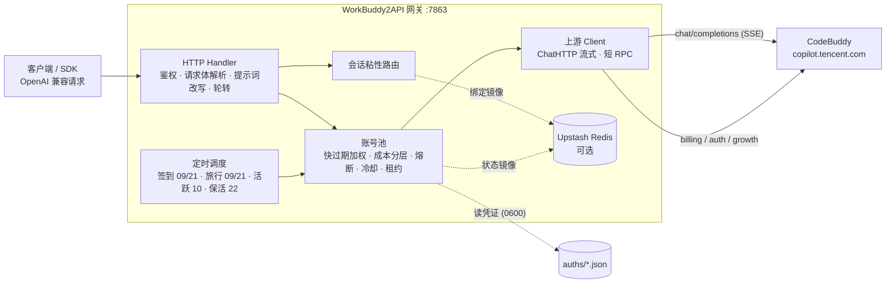

<p align="center">
  
</p>

<h1 align="center">WorkBuddy2API Panel</h1>

<p align="center">
  <b>把腾讯 CodeBuddy 账号变成 OpenAI 兼容 API 的多账号网关 · 附 Web 管理面板</b><br>
  Web 面板 · OAuth 浏览器登录 · 账号池轮转 · 熔断与冷却 · 会话粘性 · 定时签到 / 活跃 / 旅行 / 保活 · <b>成长任务推进与领奖</b> · 流式 / 非流式
</p>

<p align="center">
  
  
  
  
  
  
</p>

---

> [!CAUTION]
> ### 🚫 本项目是**学习项目**，**禁止一切商业行为**
>
> **本项目仅用于个人学习与技术研究，不得用于任何商业目的。**
> 包括但不限于：售卖、付费中转、账号池出租、按次计费、捆绑销售、代充代注册经营、
> 企业内部商业运营、引流变现、SaaS 化托管——**无论是否直接收费，只要目的是获取经济利益
> 或商业优势，均属禁止之列**。
>
> **一旦发现有将本项目用于商业活动的情形，作者将直接把本仓库私有化（转为 private）
> 并停止一切公开更新** —— 不再有修复、不再有安全补丁，所有使用者一并失去这个项目。
> 该处置由作者单方面决定，**不事先警告、不协商**。
>
> 📖 完整条款与法律现实说明见 **[NOTICE.md](NOTICE.md)**。

---

## 🤖 本项目是一个 AI 项目

> [!IMPORTANT]
> **本仓库的代码、issue 排查、代码审查、测试编写与修复实现，均由 AI 主导完成**
> （具体由 DeepSeek Harness / DeepSeek 系列模型驱动，人工负责提出需求、验证结果、
> 决定取舍与发布）。
>
> 这意味着：
>
> - **AI 产出的代码未经传统意义上的人工逐行审阅**，仍可能存在逻辑缺陷、边界遗漏与风格问题；
> - **欢迎审查**：任何你觉得不对的地方，请直接提 issue 或 PR，哪怕只是一行看不懂的代码；
> - **发现错误请以「代码事实」为准**，不要假设某个行为是刻意设计的——很多时候它只是 AI 的误解；
> - **关键场景请自行复核**：涉及账号安全、积分计费、对外暴露的部署，落地前请自行验证关键路径。
>
> 透明性说明：上游 [Sliverkiss/workbuddy2api](https://github.com/Sliverkiss/workbuddy2api)
> 与 [linguo2625469/workbuddy2api-panel](https://github.com/linguo2625469/workbuddy2api-panel)
> 的原始部分由原作者人工编写；**本 fork 自 2026-10 起的全部修复与维护工作为 AI 产出**。
> 完整披露见[「🤖 AI 项目声明与维护披露」](#-ai-项目声明与维护披露)。

> [!IMPORTANT]
> **本 fork 已于 2026-10-21 停止跟随上游。** 上游 `linguo2625469/workbuddy2api-panel` 同样于 2026-10-21
> 声明停止维护（不再更新代码、不再处理 issue / PR）。本 fork 的 `fix/all-known-issues` 分支是
> **当前唯一维护分支，也是仓库默认分支**，
> 以**发行版 v1.13.0（`d66384d`）为基线**，已吸收上游 `main` 的全部后续修复并额外修掉一批线上问题。
>
> **为什么以 v1.13.0 而不是上游 main 为基线**：v1.13.0 是绝大多数用户实际运行的发行版；
> 上游 main 相对它只多 9 个提交，其中包含一整套 DSML 层（与本 fork 的「零 tool_calls 停摆检测」交互复杂），
> 因此本 fork 把 DSML 能力**单独移植**进来，而不是整体切换基线——结果是本 fork 的 `fix/all-known-issues`
> 在功能上是**上游 main 的超集**。
>
> **本 fork 修掉而上游没有的**（详见 [与上游的差异](#-与上游的差异)）：
> 11-128 / 11140 按业务码分流、渠道校验失败不误禁账号、CN 域上游对身份句的逐字黑名单规避、
> Windows 落盘原子写、额度「未知 ≠ 0」、企业额度解析、裸模型跨域回退、搜索端点、日志落盘等。
>
> **维护方式披露**：本 fork 的 issue 排查、代码审查、测试与修复实现**全部由 AI 主导完成**，
> 详见顶部[「🤖 本项目是一个 AI 项目」](#-本项目是一个-ai-项目)。

> **本项目是 [Sliverkiss/workbuddy2api](https://github.com/Sliverkiss/workbuddy2api) 的增强分支**（fork）。
> 上游仓库现已删除；本项目**已同步至上游删库前的最后一次更新**（`ea8b1e5`），此后由本分支独立维护演进。
> 在上游基础上重构了可视化运维层；差异概览见 [与上游的差异](#-与上游的差异)，上游设计的精巧之处（账号池调度、错误分类、提示词体系）原样保留，详见下文。

> ⚠️ **本项目仅限自用账号（签到 / 保活 / 个人工具接入），不支持同时也是禁止批量小号分发额度、二次打包或收费售卖。** 详见 [使用声明（必读）](#使用声明必读)。

## 使用声明（必读）

**本项目是一个学习项目。禁止一切商业行为。**

其定位单一且明确：**个人学习与技术研究**——用于理解 OpenAI 兼容网关、流式转发、
账号池调度、错误分类与跨平台落盘的工程实现。唯一许可的用途是
**个人学习、个人自用、管理你自己的账号**。它不是一个产品、一项服务或一个解决方案。

本项目（含上游 [Sliverkiss/workbuddy2api](https://github.com/Sliverkiss/workbuddy2api)，下同）的开发初衷只有一个：**方便个人管理自己的 CodeBuddy 账号**——自动签到、保活、给自己的本地工具提供一个 OpenAI 兼容入口。它是免费、开源、按「原样」提供的个人自用工具。

近期我们发现有人将本项目用于以下行为：

- **批量注册小号 / 收购账号，对外提供付费 API、共享池、代充等业务**；
- **二次加壳、捆绑卡密（授权码）售卖**，或以「公益服」「低价中转」等名义变相收费分发。

我们对上述行为**表达最强烈的反对**，并声明如下：

1. **禁止一切商业行为。** 除适用法律强制允许的情形外，禁止将本项目（含全部或部分源码、二进制、镜像、衍生版本、二次修改版）用于**任何**商业目的，包括但不限于：售卖、付费 API 中转、账号池出租或分销、按次计费、捆绑销售、代充代注册经营、企业内部商业运营、引流变现、SaaS 化托管。**无论是否直接收取费用，只要目的是获取经济利益或商业优势，均属禁止之列。** 完整禁列清单见 **[NOTICE.md](NOTICE.md) §2**。
2. **一切商用 / 售卖行为与本项目及作者无关。** 本项目不授权、不支持、不参与任何面向公众的 API 售卖、账号池出租、卡密收费分发；行为人由此产生的一切后果（包括但不限于账号封禁、条款违约与法律风险）由其自行承担，与作者和贡献者无任何关系。
3. **批量注册与转售接口配额违反目标平台服务条款。** CodeBuddy / 腾讯系服务条款禁止批量注册账号及商业转售接口。上游仓库已删除、停止公开维护——我们无法断定具体原因，但此类滥用行为正在毁掉所有正常使用者的环境，请勿再消耗社区的善意。
4. **请勿购买任何「收费版」「卡密版」「公益中转版」。** 本项目永远免费开源。任何加壳、加密、捆绑收费的「版本」都是他人篡改的产物，与本项目无关；且此类分发无法审计，存在被植入后门、回传并窃取你 CodeBuddy 凭证的风险（`auths/` 中保存的是明文 accessToken / refreshToken）。**你付钱买到的不是本项目，而是把自己账号交给陌生人的机会。**
5. **关于开源协议的诚实说明。** 本项目基于 MIT 协议开源，MIT **在法律上允许商业使用**——我们不打算靠改协议去打赢官司。本使用声明是**项目层面的政策与作者意愿**，它不能撤销 MIT 已授予任何人的权利。因此它的实际约束力来自下面第 7 条：**作者不再公开维护**。全文见 **[NOTICE.md](NOTICE.md) §4**。
6. **作者不为任何第三方分发版本提供支持、更新承诺或安全保证。**
7. **发现商业利用 ⇒ 直接私有化仓库。** 一旦发现本项目被用于商业活动，作者将**不再沟通、警告或协商，直接把本仓库转为私有（private）并停止一切公开更新**——不再有修复、不再有安全补丁，公开访问、分支、issue、release 与镜像构建全部停止。**商业利用的代价不是「作者生气」，而是所有人都失去这个项目。** 上游的今天可能就是本项目的明天，望自重。

如果你的用途是学习或管理自己的账号，**欢迎**：正常使用、反馈问题、提交 PR、参与 code review。

## 🤖 AI 项目声明与维护披露

**本项目是一个 AI 项目。**

自 2026-10 起，本仓库（`Huiaei/workbuddy2api-panel`）的**全部维护工作——issue 排查、代码审查、
测试编写、修复实现、文档撰写——均由 AI 主导完成**，具体由 DeepSeek Harness / DeepSeek 系列模型驱动。
人工的角色是：提出需求、验证结论、决定取舍与发布节奏。

### 哪些是 AI 产出，哪些不是

| 范围 | 产出方式 |
|---|---|
| 上游 [Sliverkiss/workbuddy2api](https://github.com/Sliverkiss/workbuddy2api) 的原始代码 | 原作者**人工**编写 |
| 上游 [linguo2625469/workbuddy2api-panel](https://github.com/linguo2625469/workbuddy2api-panel) 的面板与任务体系 | 原作者**人工**编写（含其自行披露的少量 AI 辅助） |
| **本 fork 自 2026-10 起的全部修复集**（错误分类、账号池、Windows 落盘、CN 域身份句脱敏、DSML 移植等） | **AI 主导产出** |
| 本 fork 的测试用例、README 的「2026-10 之后的修复集」章节 | **AI 主导产出** |

### 这意味着什么

- **代码未经传统意义上的人工逐行审阅**。虽然每批改动都通过了 `go build` / `go vet` / `go test ./...`
  与 Windows 交叉编译专项检查（`GOOS=windows go vet` + `go test -c`），但仍然可能存在**逻辑缺陷、边界遗漏、错误假设与风格问题**。
- **行为异常时请以「代码事实」为准**。如果你在文档里读到的行为和实际表现不符，
  **那几乎总是 bug，而不是「刻意设计」**——请直接提 issue。
- **关键路径请自行复核**。涉及账号安全、积分计费、对外暴露的部署，落地前请自行验证关键路径，
  不要仅凭本文档的描述就上线。
- **欢迎审查**。哪怕只是一行看不懂的代码、或一个你觉得「AI 写错了」的地方，都欢迎提 issue 或 PR。

### 已知的 AI 产出固有风险

| 风险 | 本项目的处理 |
|---|---|
| 误判错误类型 ⇒ 误禁健康账号 | 11-128 / 11140 按**业务码**分流，渠道校验失败**零惩罚**（账号无过错） |
| 用 `displayMsg` / `displayTips` 等**提示文案**做判据 | 判据只用**主文案**（`body.msg` → `body.error.message` → …），否则一次安全提示就会让**整个网关降级** |
| 探针单次采样 ⇒ 把噪声当结论 | 本项目所有关键结论均以 **K≥3 次重复**验证后才写入文档 |
| 手写近似请求体 ⇒ 证明不了真实形态 | CN-400 根因排查中，前 8 批「手写近似 body」的探针**全部失败**；破局点是用**网关真实代码 + 真实会话实录**打真实上游 |
| 跨平台假设（POSIX 语义直接搬到 Windows） | Windows 上 `os.Open` 不带 `FILE_SHARE_DELETE` ⇒ 手写 tmp+rename 必失败；统一走 `internal/atomicfile`，并用 `GOOS=windows` 交叉编译 + `go test -c` 兜底 |

### 提交与评审

本 fork 的提交记录里，AI 产出的改动以 `DSH Agent <dsh@local>` 作为作者，便于识别。
**这些提交同样接受正常的人工审查**——请不要因为「AI 写的」就默认跳过 code review。

## 项目简介

WorkBuddy2API 是一个自托管的 **OpenAI 兼容反向代理网关**，将腾讯 CodeBuddy（`copilot.tencent.com`）账号包装为统一的 `/v1/chat/completions` 服务。

- 官方不提供 OpenAI 形态的开放 API，本项目通过 **OAuth 设备授权**（面板「添加账号」或 `login.sh`）获取账号凭证，在网关侧做 token 自动刷新、账号池调度与流量治理；
- 面向 **个人多账号** 场景：多账号共享、单号故障自动换号、冷却 / 熔断防止雪崩、会话粘性保证多轮上下文不跳号；
- 对客户端只暴露 OpenAI 兼容接口，现有 SDK / 前端 / 工具 **零改造接入**。

> ⚠️ 合规须知：本项目是**非官方**网关，使用 CodeBuddy 账号作为上游，**仅限本人授权账号、本机 / 私有环境测试**。详细边界见[安全与合规](#安全与合规)。

## 核心能力

| 能力 | 说明 |
|---|---|
| 🔑 **OAuth 一键登录** | `login.sh` 设备授权流程，自动落盘凭证并重启容器加载新账号 |
| 🔄 **多账号池** | 快过期积分加权 + 成本分层 + 加权随机选号，Top-5 候选 + 防惊群 |
| 🛡️ **熔断与冷却** | 429 软冷却 600s 起指数退避（封顶 `soft_rate_max`）、404 固定 60s 短冷却、402 硬冷却至次日 04:00、连续失败熔断、在途租约限流 |
| 🧲 **会话粘性** | 同一会话（`conversation_id`）尽量绑定同一账号，TTL 滚动续期，失败自动解绑，可镜像 Redis 防重启丢失 |
| ⏰ **定时任务** | 签到、活跃上报、猫猫旅行、token 保活、夜猫子与成长任务六类独立排程和开关；签到末尾运行连登管家，余额另按分钟间隔刷新 |
| ⚡ **流式 + 非流式** | 出站强制 `stream:true`；SSE 帧按规范白名单重建；非流式由本地聚合为单响应 |
| 🧠 **推理模型兼容** | DeepSeek 思维链注入（`thinking.type=enabled` + 默认档）、`reasoning_content` 多轮回填、effort 档位自动降级 |
| 🔍 **联网搜索** | `POST /v1/search/messages` 把上游 `/agenttool/v1/search` 包成 Anthropic Messages 兼容形态（DSH 等客户端的搜索 provider 零改动接入）；复用账号池选号 / 在途租约 / token 刷新 / 错误冷却，出站请求头对齐官方客户端 |
| 💬 **系统提示词体系** | 默认 `passthrough` 保留客户端 system；可选 `custom` 替换或 `append` 追加网关提示词；遇拦截可自动降级重试 |
| 🗑️ **指纹脱敏** | 出站请求体黑名单指纹字段清洗（可关闭），与提示词体系两层叠加 |
| 📊 **可观测** | 每请求一行表格日志（TTFB / token 速率 / uid）；`/healthz` 带 `service` 身份标识可接负载均衡 / 宿主探活 |
| 💾 **状态持久化** | 池状态本地原子落盘 + Upstash Redis 异步镜像（可选），重启择新恢复 |
| 🖥️ **Web 管理面板** | 内嵌单页面板（明暗主题，七个视图）：账号运维 / 用量与积分分析 / 模型档位条件查询 / 在线改配置（热生效）/ 运行日志（含**调用来源 IP·UA** 与时间区间）/ 积分任务，见 [Web 管理面板](#-web-管理面板) |

## 🎯 成长任务推进与领奖

国内区可由面板尝试执行代码中已有的任务动作，再读取服务端进度；只有服务端确认达标后才会领奖。可执行项由账号当前任务列表、解锁状态及已实现动作共同决定，活动内容和奖励也以上游当前返回为准，因此不承诺固定任务数或固定收益。动作请求成功本身不表示计分或领奖成功。国际区任务目前只支持查询，accept、领奖和自动动作均关闭。

任务列表带 `progress_known` 与 `reward_known`：为 `false` 时，上游没有提供对应信息，省略的 `current`、`target` 或奖励字段代表未知，不代表 0。逐项结果中，`done` 表示已确认领取或领奖接口成功；`awaiting_progress` 表示动作已发送但尚未确认进度；`claim_pending` 表示进度达标但领奖失败；`skipped` 和 `error` 分别表示未执行和执行/查询失败。批量接受结果 `accepted` 只表示报名成功。已领取或服务端已确认达标的任务会跳过动作；但再次运行仍可能触发真实模型对话等操作并消耗积分，不能假定所有动作都幂等或零成本。

国区新账号通过面板登录或导入时会自动排入后台任务；已有国区账号按 `schedule.growth_hours` 每日排入（默认本地时区 01:00），也可从账号任务页手动启动。新增账号和每日触发共用 `schedule.growth_enabled`（默认开启）；关闭后暂停这两种自动触发，手动启动仍可用。每个账号同一时间只运行一个任务作业，后台最多并发处理 2 个账号。

`POST /panel/api/accounts/{uid}/tasks/auto_all` 现在只负责启动作业并立即返回 HTTP 202：`{"ok":true,"started":true,"job":{...}}`。`started:false` 表示该账号已有活动作业并返回现有作业。HTTP 202 表示已受理，不表示作业或任务已完成；已有客户端应改为轮询 `GET /panel/api/accounts/{uid}/tasks/job`（返回该账号最新作业）或 `GET /panel/api/tasks/jobs`（返回 `auto_enabled` 和各账号最新作业）。关闭页面不会停止作业。`job.status` 描述作业生命周期（`pending`、`running`、`finished`、`interrupted`、`error`），`job.completed` 是本轮已处理的任务项数，不代表成功数；请查看 `job.results[].status` 和进度字段判断结果。作业结束只表示本轮处理完毕。

作业原子保存在 `state_file` 同目录的 `task-jobs.json`，每个账号保留最新作业，最多 256 个账号。重启时遗留的 `pending` / `running` 作业会标成 `interrupted`，随后恢复账号仍存在、未禁用且可取得任务锁的作业：手动作业不受自动开关限制；新账号和每日作业仅在 `schedule.growth_enabled` 开启时恢复。恢复会重新读取服务端状态，不会把“动作已发送”当作完成。

成本账本升级时，旧状态里没有可信扣费来源标记的零价观测会迁移为未知；已有积分余额、用量与冷却状态不受影响，正价观测保留。只有带有效用量信息的上游 `usage.credit` 才会形成新的实测价格，缺失费用不视为免费。账号余额估算会保留小额费用的小数部分，避免逐次取整漏记，并用于积分保底判断。

### 🧭 任务中心（面板新视图）

「任务中心」视图把散落的任务能力收拢成一处：

- **全账号任务扫描**：对启用的国区账号只读查询默认和小程序口径的成长任务并按任务码去重，保留跳过原因和查询错误；仅把已配置自动动作且未领取、未锁定的任务列为待办，不表示所有任务都可自动完成
- **执行队列**：按账号串行执行已扫描待办，与单项动作共用账号锁；账号间并发可设为 1–4。队列状态可轮询
- **后台作业**：显示新账号、每日和手动触发的国区自动作业，按账号查看当前项和结果；每个账号的最新作业持久化，最多保存 256 个账号。作业最多并发处理 2 个账号，页面刷新或关闭不影响执行
- **日志分频道**：任务 / 对话 / 系统各保留最近 500 行，互不淘汰；任务日志独立保存到 `state_file` 同目录的 `task-logs.json`，重启后可查询最近执行结果。

<details>
<summary><b>🎒 开学季活动（5/5 全自动）</b>——活动期至 2026-09-24，已结束；逆向成果存档，点击展开</summary>

官方「AI 好 Buddy，开学有好礼」小程序活动的 5 个任务**全部纯 API 自动完成**（挂签到排程末尾，幂等）：

| 任务 | 奖励（每日） | 判据（已逆向） |
|---|---|---|
| 分享活动 | +100c +1抽奖 | `share-complete` 直调即点亮 |
| 桌面端体验（单次） | +100c +1抽奖 | viewed 激活 + 真实 chat + 桌面六事件链 |
| 和 AI 对话 3 次 | +50c +1抽奖 | viewed 后 3 条 `chat_request_send` 埋点（无需真实会话） |
| 召唤开学季专家 | +50c +1抽奖 | viewed 后 mp 事件链（召唤×3 + 对话） |
| 学生认证 | +100c | 需微信学生真实认证，不做 |

抽奖次数自动全部抽完。期间逆向成果（cf-connect 加密通道、mp 云对话全链路）记录在 `data/desktop-task-protocol.md` §8。

同一活动在成长任务中心还有两条**小程序口径**任务（`X-Client-Platform: miniprogram` 专属下发，默认列表不可见，各 +100c+5e）：

| 任务 | 判据（已逆向） |
|---|---|
| `school_season` 校园日 | mini `chat_request_send` + `activityId=school_open_day_2026`（无 activityId 不点亮；accept/claim 均要求 mp 头） |
| `Sequential_Tasks_1` 小程序首对话 | mini `chat_request_send`（无 activityId，服务端按 source=mini_program 指纹关联） |

任务中心扫描自动合并 mp 口径待办；accept 带**登记回读验证**（上游存在 200+OK 但未落账的形态，未生效自动重试一次）。

</details>

### 连登兑换与抽奖（自动）

成长中心连登档位（连续登录 7/14/28 天）兑换后发放积分 / 能量 / 补签卡 / **抽奖次数**，抽奖次数只能从兑换获得。网关把它挂在每日签到排程末尾自动跑闭环（见[定时任务](#定时任务)）：档位解锁当天自动兑换、有抽奖次数自动抽完，全程无需人工盯。

## 🆚 与上游的差异

本分支相对 [上游 master](https://github.com/Sliverkiss/workbuddy2api) 的增量（均已在真实多账号环境验证）：

### 新增

| 能力 | 说明 |
|---|---|
| **Web 管理面板** | `internal/panel`，前端 go:embed 单文件进二进制，零外部依赖。账号池可视化（健康色条 / 积分量条 / 冷却倒计时）、积分到期分布、单号运维、批量任务、日志查看、明暗主题 |
| **请求指标与脱敏日志** | 面板展示完成成功率 / HTTP 成功率 / 平均耗时 / 最近请求，响应带 `X-Request-Id`；JSONL 只归档请求元数据，不写提示词、响应正文或凭证 |
| **浏览器内 OAuth 添加账号** | 面板「添加账号」按钮完成设备授权 → 凭证落盘 → **热加载进池（免重启）**，替代命令行 `login.sh` 流程 |
| **在线配置编辑（热生效）** | 面板直接改 `config.json`：API 密钥 / `soft_rate` / 脱敏开关 / 池参数 / 任务排程**立即生效**；装配期字段（listen 等）保存后提示需重启。写入采用深合并 + 原子替换，保留未知键 |
| **积分任务体系** | 任务列表 / 接受 / 领取接口 + 面板弹窗和异步后台作业；对有对应动作的国区任务尝试推进（「一键完成」覆盖 **17 个任务**：对话 / 领养 / 桌面行为链 / 模板 / 灵感案例 / 画布 / 专家召唤 / 技能尝鲜 / 主题 / 资料库 / 夜猫子等），回读服务端进度并在**确认达标后领奖**，纯 API 零客户端依赖；任务范围、进度和奖励取决于上游实际返回。国际区仅查询 |
| **限时补偿可观测（issue #189）** | 官方补偿（例：「模型服务异常额外补偿 500 积分」）在账号侧可见，网关改为**先查 `compensation-status` 再决定是否领**：面板「官方补偿」卡片列出待领账号 + 领取截止倒计时（≤48h 标红）+ 逐号/全量领取按钮；**查询失败的账号在卡片上显形为红色行，不会与「没有补偿」混为一谈**；每日签到排程同步走「查→领」，**状态查询失败与领取失败一律显式告警**（旧实现把「没有 / 已领 / 领取失败」三态压成同一形态，带截止日的补偿会静默过期） |
| **首启自动生成配置** | 目录下无 `config.json` 时自动生成推荐配置（含 `crypto/rand` 随机 `api_key`），双击即开 |
| **粘性会话内容回退** | 客户端不发 `conversation_id` 时，用 `system + 首条 user` 哈希派生会话键（`d-` 前缀），通用 OpenAI 客户端也能享受粘性 |
| **余额后台刷新** | `schedule.balance_refresh_minutes`（默认 5）周期查余额并更新池，冷却账号余额恢复自动解冻 |
| **模型能力透出** | `/v1/models` 附带 `supported_efforts` / `default_effort` / 积分倍率 / 输入输出上限等上游真实字段 |
| **安全加固** | 常量时间密钥比较（`internal/httpauth`）、CSP 与安全响应头、UID 白名单防路径穿越、前端属性转义修复 |
| **领养前置修复** | 上游 `travelAdopt` 缺 report 前置导致领养恒失败于 `first_buddy task not completed yet`；本分支修正后实测 +300 到账（3/3 账号） |

### 同步上游

**第一轮（fork 基线 `53ee3a1` → `9a87758`，34 个提交）**：四类任务独立排程、pool 文件拆分、12153 连续计数才禁用、429 `code=6004` 模型级限流收窄、11101 不罚号、请求体 413、DeepSeek 思维链、reasoning_content 回填、Codex 指纹脱敏、系统提示词体系、出站 UA 可配等。

**第二轮（`9a87758` → `ea8b1e5`，2026-09-14，只吸收底层）**：

| 上游改动 | 吸收内容 |
|---|---|
| 净化增强 | `tool_calls.arguments` 盲区修复（content=null 的工具调用轮此前完全漏净化）、裸 `11128` 反探测改写、桌面版身份句（逗号形态）漏网修复、反馈句整句改写 |
| 出站头族 | UA 对齐官方三段式 `WorkBuddy/<ver> WorkBuddy/<ver> CLI/<ver>`（默认 5.5.4/2.137.1，可配）；`X-IDE-*` 用量归属四头 + `X-Agent-Purpose`（`client_name` 配 `WorkBuddy` 即对齐官方桌面端）；`X-Device-Token` 设备风控头（auth 每号 / config / 文件三源）；`X-IDE-Version` 补齐 |
| 并发修复 | 客户端 IP 改按请求参数传递（消除共享字段竞态）；billing 单段 UA 形态 |
| 签到幂等 | `IsAlreadyCheckin` 识别"今天已签到"（code=10001/14001），调度日志不再把重复签到当失败 |
| 粘性按模型判活 | 会话绑定的账号被 6004 模型级限额后，换模型请求自动解绑重分配（治"限额后换不动号"）；`/healthz` 探活计入模型豁免形态（治"全号被单模型限流探活误报 503"） |
| report 增强 | `ReportChatActivity` 支持独立 `requestID`（同会话多轮上报各条可区分） |

未吸收（明确不做）：脚本体系（task_runner/school 脚本—我们已有更完整的纯 API 实现）、governance/CI workflow（本仓库已主动关闭 Actions，改手工构建，见 [`BUILD.md`](BUILD.md)）、成本账本选号（依赖 usage.credit 观测，收益待验证）。

> 上游仓库此后已删除，上述第二轮（`ea8b1e5`）即其**删库前的最后一次更新**，本分支已完整吸收。此后本仓库与上游不再有同步关系，演进以本仓库为准。

### 合并自其他分支的内容（来源清单）

本分支不是一次性写成的：它是把**上游 PR、若干第三方 fork、以及本项目自己的多条工作分支**
的内容合并到同一条 v1.13.0 基线上得到的。下表逐项说明**合并了什么、从哪来、现在在哪**。

#### 来自上游 `linguo2625469/workbuddy2api-panel` 的 PR

上游共 105 个 PR。**28 个在 v1.13.0 之后合并进上游 `main`（`73a7560`）的 PR，全部已吸收**：

| 上游 PR | 内容 | 本分支中的位置 |
|---|---|---|
| #123 | 还原模型原生工具调用标记，修 Codex 回合空转（DSML） | `internal/upstream/dsml.go`（并修了上游 `[]map[string]any` 守卫失效、会被还原调用覆盖真实调用的 bug） |
| #133 | 无 `conversation_id` 时 `prompt_cache_key` 回退会话 key | `internal/server/handler.go` |
| #138 | 运行日志下新增「积分历史」，逐账号记录余额变动 | `internal/panel/` + `internal/credithist/` |
| #143 | 手机端适配（抽屉侧栏 + 宽表卡片化 + 窄屏时序图） | `internal/panel/mobile.css`、`mobile.js` |
| #144 | 出站 DNS 可指定（`dns_servers` / `WB2A_DNS`） | `internal/upstream/dns.go` |
| #148 | 剔除 `function.name` 为空的 `tool_call`（修线上 11133） | `internal/upstream/tool_pairing.go` |
| #152 | 积分到期提醒卡片默认可见，用 overview 快照渲染 | `internal/panel/index.html` |
| #158 | 按地区独立配置轮询与顺序耗尽调度 | `internal/pool/strategy.go` |
| #159 | 剥离 `content` 里的 `reasoning_text` 片段 | `internal/upstream/payload.go` |
| #162 | 识别企业切换会话（`token_source=enterprise_switch`） | `internal/auth/auth.go` |
| #178 | 账号备注与积分到期提醒折叠 | `internal/panel/app.js` |
| #185 | `6021 queue.full` 归类为渠道级忙碌 | `internal/upstream/client.go`、`hint.go` |
| #196 | 补偿状态可观测化（先查后领 + 截止倒计时 + 面板入口） | `internal/scheduler/compensation.go` |
| #199 | 缓存告警假阳性——miss 显式存在时对称反推 hit | `internal/server/logging.go` |
| #202 | 软冷却到期后不再透出过期 `reason` | `internal/pool/state.go` |
| #203 | 模型级 6004 双时钟 | `internal/panel/app.js` |
| #204 | 一键完成遇「已达标未领」先补领再跳过 | `internal/panel/autotask.go` |
| #205 | 任务补领清扫（周期幂等） | `internal/panel/tasksweep.go` |
| #212 | 到期提醒快照与「检查」同口径，按日聚合到期批次 | `internal/pool/cooldown.go`、`internal/panel/` |
| #213 | 接入 WorkBuddy 联网搜索端点 `POST /v1/search/messages` | `internal/server/` + `internal/upstream/` |
| #217 | 同账号 refresh 单飞，避免 RT 复用撞 12153 掉登录 | `internal/upstream/client.go` |
| #220 | 新增 `cn.chat_base` | `cmd/server/config.go` |
| #221 | 区分模型权限错误（11158）并展示 Global 模型可用性 | `internal/upstream/client.go`、`internal/panel/app.js` |
| #223 | 支持从环境变量读取代理 | `internal/upstream/transport.go` |
| #225 | `models.hidden` 黑名单 | `internal/livecfg/livecfg.go` |
| #230 | Go 下载源改为国内源 | `Dockerfile`、`BUILD.md` |
| #232 | 裸模型名跨域回退（默认关闭） | `internal/pool/realm.go` |
| #233 | 11-128 通道校验分流 + 始终发送 `X-Conversation-ID` | `internal/upstream/headers.go`（本分支改成**业务码优先**，比上游更宽，见下文「与上游的差异」） |

**上游停更后新开的 8 个 PR（#244 / #246 / #247 / #248 / #249 / #250 / #251 / #252）**——
上游在 2026-10-21 声明停止维护，这些 PR 无人合并。逐个核验后的处置：

| 上游 PR | 内容 | 处置 |
|---|---|---|
| #244 | 按临期窗口刷新 token | **已采纳**（`868757b`） |
| #246 | 修账号池表体整表空白 + 渲染异常不再静默（issue #241） | **已采纳**（`96181ba`，我方本就有同一缺陷，先修） |
| #247 | 企业形态判定收敛为 `enterpriseId`，不再误挡个人版账号（issue #240） | **未采纳**——与本分支 2026-10-12 的一手实测结论冲突；双方证据与分歧点见 [UPSTREAM-MERGE-NOTES.md](UPSTREAM-MERGE-NOTES.md) |
| #248 | 清掉上行请求体/请求头里的项目自证标识（issue #239） | 功能**早已等价落地**；补了守护测试（`aac0e71`） |
| #249 | README 补「客户端接入」一节 | **已采纳**（README「客户端接入」章节） |
| #250 | 模型级限流导致账号池 / 模型锁池 / 积分到期提醒整块空白 | **已采纳**（`96181ba` 的三块渲染隔离） |
| #251 | 补齐 `rateLimitMeta` 未声明的 `detail` | **已采纳**（`96181ba`） |
| #252 | 前端冒烟测试 + 请求体解析收敛 | **已采纳思路**（`b2c3ba3`：25 处切片测试纳入严格模式） |

#### 来自第三方 fork 与本项目工作分支

| 来源 | 合并了什么 | 现在在哪 |
|---|---|---|
| 报告者 fork（`misakano7545/workbuddy2api-panel`） | 官方客户端出站指纹对齐（双版本真机抓包）、首条消息恒为 system、企业额度「不限量」哨兵不污染权重、突发积分与低缓存率两道快速闸、14003 模型繁忙独立短窗口 | `internal/upstream/headers.go`、`internal/prompt/prompt.go`、`internal/pool/`、`internal/server/budget*.go` |
| 本项目 `fix/all-known-issues-v1.13.0` 分支 | 早先基于上游 `main` 做的 200+ 项修复中的**自研部分**（错误分类、账号池、面板可观测性、Windows 落盘加固） | 已全部并入本分支；该分支不再单独维护 |
| 本项目 `feat/rebase-on-main` 分支 | Codex Responses / Anthropic Messages 原生协议与官方检索透传 | `4db668d` → `internal/server/responses.go`、`messages.go` |
| 本项目 `sweep/*` 分支（7 条） | #104 后台任务+计费、#213 搜索端点、#237/#238 优惠与试用熔断、#244 临期刷新 | 已全部并入；这些分支**零独有提交** |
| 本项目 `triage/*` 分支 | 20 条无 PR 覆盖的 issue 的修复（软冷却 reason、到期卡片快照、企业额度解析口径等） | 已全部并入 |

> 本分支保留的**唯一**分支是 `main`——它与上游 `main`（`73a7560`）保持完全同步，**只作对照**，不接收修复。所有修复都进 `fix/all-known-issues`（默认分支）。

### 2026-10 之后的修复集（本 fork 独有）

上游 `linguo2625469/workbuddy2api-panel` 于 2026-10-21 停止维护。本 fork 在其停止前
把上游 `main`（`73a7560`）的**全部修复吸收进来**（含 11158 模型权限锁、reasoning_text 剥离、
6004 双时钟、缓存 miss 假阳性、cn.chat_base、ProxyFromEnvironment、models.hidden、
裸模型跨域回退、区域调度、补偿可观测、到期提醒快照、DSML 原生工具调用还原等），
并在此基础上修掉了下面这批上游没有的问题：

#### 错误分类与账号惩罚

| 症状 | 上游行为 | 本 fork 行为 |
|---|---|---|
| `11-128` / `11128` 渠道校验未通过 | 计入账号失败 → 健康账号被降级 / 禁用（issue #188 / #197 / #231） | **账号无过错**：不冷却、不禁用、不计入失败；按业务码 + 主文案判定，且 `11-128`（字符串码）与 `11128`（数字码）**两种形态都认** |
| `11140` + `request illegal` | 与普通 4xx 混同 | 判定为**账号被限制** → 禁用并提示在 WorkBuddy 提交反馈申诉 |
| `11140` 但文案是「模型提供方正在限流」 | 一律当封禁 | 仍按**软限流**处理（不误禁用账号） |
| 裸 `{"msg":"request illegal"}`（无业务码） | 计入账号失败 | 归为**客户端错误**，不惩罚账号 |
| 判据来源 | 混用 `displayMsg` / `displayTips` | **只看主文案**（`body.msg` → `body.error.message` → `body.error.msg` → `body.message`）。此前用 `displayMsg` 判「安全策略拦截」会让**整个网关降级到次日 0 点** |
| 流式 SSE error 帧 | 丢业务码 → 健康账号被误降级 10 分钟 | error 帧分类**保留完整业务信封**（含 `displayMsg` / `displayTips`） |
| `6021` / `queue.full` | 池级冷却 | 渠道级忙碌 + 透传上游 `Retry-After`（**不伪造**） |

#### 模型目录与优惠

| 症状 | 上游行为 | 本 fork 行为 |
|---|---|---|
| 「错峰使用 / 夜间折扣」类优惠只有 hover 文案、无机器可读 `factor` | 客户端拿牌价，错峰实付 `x0.085` 却显示 `x0.17`（选型被误导） | 从文案派生时段与折扣，`/v1/models` 透出 `promo_*` 一组；派生值标 `promo_derived` 区分置信度（上游 PR #237） |
| 试用/限免模型免费期**静默结束**（无通知） | 照常发请求、继续扣分 | 可选**自动熔断**：`usage.credit > 0` 或 `promo_valid_until` 到点即持久禁用；上游延长则自动复活（同一份已证伪的声明不再用于复活）。**默认名单留空**——不配置即完全不动（上游 PR #238，落盘改走 `atomicfile`） |

#### 思考强度档位透出

**症状**：客户端（magpie / Codex 目录口径）请求模型时**看不到任何可选的思考强度档位**，
只能用一个默认档。

**根因**：不是能力缺失，是**字段名错**。客户端读的是 `supported_reasoning_levels`
（magpie 的模型列表结构里就是这个字段），读不到就当模型没有档位 ⇒ 模型选择器里
根本不出现档位选项。本项目此前只写了自造的 `reasoning_supported_efforts`——
客户端不认这个字段名，于是全部信息被丢弃。

**修复**：`/v1/models` 同时写两个名字，载荷形态与 Codex 目录一致：

```jsonc
"cn:deepseek-v4.1-flash": {
  "supported_reasoning_levels": [ {"effort": "low"}, {"effort": "high"}, {"effort": "max"} ],
  "default_reasoning_level": "high",
  "reasoning_supported_efforts": ["low", "high", "max"],  // 旧名，保留给已按旧名对接的客户端
  "reasoning_default_effort": "high"
}
```

新名（`supported_reasoning_levels` / `default_reasoning_level`）是客户端真正认的；
旧名保留是为了不打断已按旧名对接的客户端。**载荷形态错一个字节客户端就当没有档位**
（`levelsOf` 接受纯字符串数组与对象数组两种写法，给对象数组是因为 Codex 目录本身就是
这么写的），所以形状由测试钉死（`TestModelsDynamic`）。

> 档位来源仍是「远端 `supportedEfforts` 权威 → 静态兜底表」两级（`upstream.EffortListing`），
> 本次只修「透出给客户端的那一层的字段名与载荷形态」。

#### 上游渠道校验对身份句的逐字黑名单

2026-10-21 起，CN 域上游对**本产品（DeepSeek Harness）的身份句**新增逐字黑名单，命中即
`400 code=11128 "Illegal API invocation from an unapproved channel"`。这不是账号问题、不是出站头问题、
不是请求体字段问题——是**一句话逐字命中**：

| 黑名单句 | 命中条件 | 改写后 |
|---|---|---|
| `You are an AI agent powered by DeepSeek Harness` | 独立成句 | `You are an AI agent powered by the DSH runtime` |
| `You are interacting with the user through the DeepSeek Harness Web GUI…` | **两句连体 221 字符**才命中 | `You are interacting with the user through the DSH web interface` |

两条**互相独立**，必须同时改。产品名本身**不能全局替换**——路径形态
`C:\app\DeepSeek Harness\…` 不被拦（改了会让模型拿到错路径），所以实现里只改写整句、
并对残留产品名做**路径感知**的别名替换。工具声明（`tools[].description` / 参数 schema）同样走脱敏。

> 该黑名单是上游在 2026-10-20 19:xx ~ 10-21 01:22 之间新增的：10-19 / 10-20 同样的句式全部 200。

#### 账号池

- **「额度未知」≠「额度为 0」**：上游把 `total_tokens <= 0` 当成 0 积分上报，配置了
  `credit_floor > 0` 的部署会**静默挡掉所有新账号**。本 fork 用 `creditsKnown` 区分二者，
  面板显示「未知」。
- **无限额度哨兵不再撑大分母**：上游用 `1<<40` 表示无限额度，直接参与权重归一化 ⇒
  无限额度账号**独占全部流量**。本 fork 改用**第二大的真实余额**作分母。
- **燃尽熔断（burn guard）**：按时间窗的花费速率熔断；面板显示燃尽状态；
  「解冻」会一并清除熔断。
- **软冷却到期后不再透出过期 reason**（修面板「可用 + 历史 429」并排）。
- **402 硬冷却的到期时间跟上游时区走**，不跟部署机器本地时区。
- **12153 连续 3 次才禁用**（与调度器口径一致），不再一次就封。

#### 落盘与并发（Windows 专项）

Go 的 `os.Open` 在 Windows 上**不传 `FILE_SHARE_DELETE`** ⇒ 任何进程持有目标句柄时，
`MoveFileEx(..., MOVEFILE_REPLACE_EXISTING)` 必返 `ERROR_ACCESS_DENIED`。上游手写的
tmp + rename 把它当致命错误 ⇒ **后台任务状态在 Windows 上永远存不下去**。本 fork 统一走
`internal/atomicfile`：唯一暂存名 + 原地覆盖降级 + 忙重试（40 次 × 5ms），并覆盖
配置、账号凭证、任务状态、任务日志四条落盘路径。Windows 侧用 `GOOS=windows go test -c` 交叉编译验证。

#### 上游交互细节

- **企业额度解析**（issue #222）：键名归一化（`credit` / `Credit` / `CREDIT` / `credit_` / `limitNum` / `limit_num` 等价）、
  取值**与 map 遍历顺序无关**、类型不匹配**不静默当 0**、`used` 向上取整（保守）、
  `data: null` 显式判空。
- **剔除 `function.name` 为空的 `tool_call`**（修线上 11133）。
- **无 `conversation_id` 时 `prompt_cache_key` 回退会话 key**：否则始终发送的
  `X-Conversation-ID` 会让上游前缀缓存**永不命中**（费钱且变慢）。
- **始终发送 `X-Conversation-ID`**（空则随机 32 hex），对齐官方客户端。
- **裸模型名跨域回退**（默认关闭）。
- **同账号 refresh 单飞**，避免并发刷新复用已消费的 RT 撞 12153 掉登录。
- **`/v1/search` 与 `/v1/search/messages`** 搜索端点，且**计入在途租约**（不绕过 `max_in_flight`）。

#### 可观测性

- **运行日志落盘** `logging.log_file`（Windows 上没有控制台也能查）。
- `WB2A_DUMP_BODY` 开关：打印入站 / 出站 body（截断 4000 字符，Authorization 只打长度）。
- 积分历史（按账号）、积分到期卡片、停摆率、请求级 JSONL 日志、搜索请求计入记账。

## 架构总览



上游请求在出站前经历统一的改写管线（`internal/upstream/payload.go`）：强制 `stream:true`、`developer` 角色归一、tool_choice 归一、`image_url` 字符串兼容为 OpenAI 对象形态、DeepSeek 思维链注入、`reasoning_effort` 档位降级、`reasoning_content` 回填、指纹脱敏。

## 快速开始

### 环境要求

- **Docker + Docker Compose**（服务端部署方式，镜像内已含低权限用户与全部工具脚本）——或
- **Windows / macOS / Linux 直接跑单文件二进制**（无需 Docker，见下方「Windows 单文件运行」）
- 一个或多个已注册的 CodeBuddy 账号，用于 OAuth 登录
- 宿主机 Go ≥ 1.22（仅从源码构建时需要）

> 🔧 **本仓库已关闭 GitHub Actions**（无自动构建、无自动发版、无自动镜像推送）。
> 想自己编译或打包发布，见 [`BUILD.md`](BUILD.md)「构建与发布说明」。

### 方式〇：GHCR 镜像（免克隆免构建）

> ⚠️ **本仓库已关闭 GitHub Actions**，镜像**不再自动构建与推送**。
> 下列镜像由上游 `linguo2625469/workbuddy2api-panel` 发布，其构建口径可能与本 fork 的代码不一致；
> 要用**本 fork 的代码**，请走**方式〇之二：本地构建镜像**（见下），或按 [`BUILD.md`](BUILD.md) 手工构建。
> `ghcr.io/huiaei/workbuddy2api-panel` 这个地址下**没有镜像**（上游 Actions 同样已停）。

`git clone` 之外的部署路径（**上游镜像**）：

```bash
# 1. 准备配置与数据目录
mkdir -p auths data && cp config.example.json config.json
#    建议编辑 config.json 设置 api_key（或留空由程序自动生成随机密钥）

# 2. 拉取并运行
docker run -d --name workbuddy2api \
  -p 7863:7863 -e TZ=Asia/Shanghai \
  -v ./auths:/app/auths -v ./data:/app/data -v ./config.json:/app/config.json \
  ghcr.io/linguo2625469/workbuddy2api-panel:latest

# 3. 健康检查（无可用账号时返回 503）
curl -s http://localhost:7863/healthz
```

> **首次发布后须将包设为公开**：GitHub 仓库页 → Packages → `workbuddy2api-panel` →
> Package settings → Change visibility → Public，否则拉取需要 `docker login ghcr.io`。
>
> 镜像 tag 规则（**上游仓库的历史规则，本 fork 不再自动推送**）：`main` 分支推送 `latest` / `main` / `sha-xxxxxx`；
> 打 `v*` tag 额外发布 `1.2.3` / `1.2` / `1` 语义化版本。

### 方式〇之二：本地构建（本 fork 的修复版镜像）

上游 GHCR 镜像仍是**未修复**的版本（`11-128` 会被误判为账号封禁而永久禁用好号、
`6021` 队列满被当限流冷却等）。要部署本 fork 的修复版，从源码构建：

```bash
git clone https://github.com/Huiaei/workbuddy2api-panel.git
cd workbuddy2api-panel
git checkout fix/all-known-issues    # 以 1.13.0 发行版为基线的修复版（默认分支）
docker build -t workbuddy2api-fixed:latest .
docker run -d --name workbuddy2api \
  -p 7863:7863 -e TZ=Asia/Shanghai \
  -v ./auths:/app/auths -v ./data:/app/data -v ./config.json:/app/config.json \
  workbuddy2api-fixed:latest
```

> `fix/all-known-issues`（**默认分支**）= **精确的 1.13.0 发行版**（tag `d66384d`）+ 全部已知问题修复，
> 并单独移植了 1.13.0 之后上游的 DSML 等能力 ⇒ 功能上是上游 `main` 的**超集**。
> 仓库的 `main` 分支则与上游 `main`（`73a7560`）保持同步，**仅作对照参考，不维护**。

### 方式一：Docker Compose（推荐服务器部署）

```bash
# 1. 克隆（本 fork：默认分支即含全部修复）
git clone https://github.com/Huiaei/workbuddy2api-panel.git
cd workbuddy2api-panel
git checkout fix/all-known-issues

# 2. 准备配置（compose 挂载此文件，缺失会导致容器启动失败）
cp config.example.json config.json
#    建议编辑 config.json 设置 api_key（或留空由程序自动生成随机密钥）

# 3. 启动（首次会构建镜像，约 1-2 分钟）
docker compose up -d --build

# 4. 健康检查（无可用账号时返回 503）
curl -s http://localhost:7863/healthz
# {"healthy":0,"total":0,"service":"workbuddy2api"}
```

启动后打开 **`http://localhost:7863/panel/`**，用面板「添加账号」完成登录（见下节）。

常用运维命令：

```bash
docker compose logs -f          # 跟踪日志
docker compose restart          # 重启
docker compose down             # 停止并移除容器（数据在 ./auths 与 ./data，不受影响）
```

### 方式二：Windows 单文件运行（无需 Docker）

```powershell
# 1) 下载 Release 中的 wb2api.exe，或从源码构建
go build -trimpath -ldflags="-s -w" -o wb2api.exe ./cmd/server

# 2) 直接运行：首次启动自动生成 config.json（含随机 api_key，日志打印一次）
.\wb2api.exe -config config.json

# 3) 浏览器打开面板添加账号
#    http://127.0.0.1:7863/panel/
```

exe 为**单文件自包含**（前端资源已 embed 进二进制），拷到任意 Windows 机器即可运行，只需保证 `auths/`（凭证）与 `data/`（状态）目录可写。

### 方式三：源码运行（开发调试）

```bash
go build ./...
go vet ./...
go test ./...                      # 完整测试套件
go run ./cmd/server -config config.json
```

构建全部二进制：

```bash
CGO_ENABLED=0 go build -trimpath -ldflags="-s -w" -o wb2api ./cmd/server
CGO_ENABLED=0 go build -trimpath -ldflags="-s -w" -o signin_bin ./cmd/signin
CGO_ENABLED=0 go build -trimpath -ldflags="-s -w" -o login ./cmd/login
CGO_ENABLED=0 go build -trimpath -ldflags="-s -w" -o credit ./cmd/credit
```

### 添加账号（登录）

**方式 A：Web 面板（推荐，各平台通用，免命令行）**

打开 `http://127.0.0.1:7863/panel/`，点右上角「**添加账号**」：面板展示授权链接 → 浏览器完成登录 → 自动检测并落盘凭证 → **热加载进池（无需重启）**，顺带完成首次签到。

**方式 B：命令行脚本（仅 Linux / macOS，依赖 bash + python3）**

```bash
./login.sh
# 按提示在浏览器打开授权链接 → 回到终端确认 → 凭证落盘 auths/workbuddy-<uid>.json
```

`login.sh` 内置授权 URL 获取 + 浏览器登录 + token 轮询 + 首次签到 + 凭证落盘 + 容器重启，全程无 PKCE（state 由服务端签发）。账号池在容器启动时用 `auths/` 目录自动对齐，新增凭证文件即自动发现。

> Windows 用户请用方式 A（或 WSL）；`login.sh` 需要 python3。

### 验证

```bash
# 模型列表
curl -s http://localhost:7863/v1/models -H "Authorization: Bearer your-api-key"

# 账号状态（汇总 + 每账号详情，disabled 账号透出 disabled_reason）
curl -s http://localhost:7863/status -H "Authorization: Bearer your-api-key"

# 流式聊天
curl -sN http://localhost:7863/v1/chat/completions \
  -H "Authorization: Bearer your-api-key" \
  -H "Content-Type: application/json" \
  -d '{"model":"deepseek-v4-flash","messages":[{"role":"user","content":"hi"}],"stream":true}'

# 非流式聊天（本地聚合）
curl -s http://localhost:7863/v1/chat/completions \
  -H "Authorization: Bearer your-api-key" \
  -H "Content-Type: application/json" \
  -d '{"model":"deepseek-v4-flash","messages":[{"role":"user","content":"hi"}],"stream":false}'

# 联网搜索（Anthropic Messages 兼容形态，走上游 /agenttool/v1/search）
curl -s http://localhost:7863/v1/search/messages \
  -H "Authorization: Bearer your-api-key" \
  -H "Content-Type: application/json" \
  -d '{"model":"deepseek-v4-flash","tools":[{"type":"web_search_20250305","name":"web_search"}],
       "messages":[{"role":"user","content":"Perform a web search for the query: OpenAI 最新模型"}]}'
```

## 客户端接入

网关对外暴露 **OpenAI 兼容**（`/v1/chat/completions`）、**Anthropic Messages 兼容**
（`/v1/messages`、`/messages`）与 **Responses 兼容**（`/v1/responses`）三套入站协议，
都指向同一个上游池。

### 端点一览

| 端点 | 协议 | 说明 |
|---|---|---|
| `POST /v1/chat/completions` | OpenAI Chat Completions | 通用入口，绝大多数客户端走这里 |
| `POST /v1/messages`、`POST /messages` | Anthropic Messages | 官方 SDK 用 `x-api-key`；`Authorization: Bearer` 也接受 |
| `POST /v1/responses` | OpenAI Responses | `instructions` → system 消息，`input[]` → messages |
| `POST /v1/search/messages`、`POST /v1/search` | Anthropic 风格的联网搜索 | 走上游 `/agenttool/v1/search`，**不是**对话转发 |
| `GET /v1/models` | OpenAI Models | 返回带 `cn:` / `global:` 前缀的模型 id |
| `GET /status`、`GET /healthz` | — | 账号池汇总 / 探活 |

> `/v1/search/messages` 是**搜索**端点，与 Anthropic 的 `/v1/messages` 对话端点**不要混淆**。

### Claude Code（Anthropic Messages 协议）

Claude Code 发的是 Anthropic Messages 形态。本网关**原生支持** `/v1/messages`，
所以可以直接指过去，不需要任何协议翻译中间层：

```json
{
  "ANTHROPIC_BASE_URL": "http://127.0.0.1:7863",
  "ANTHROPIC_AUTH_TOKEN": "your-api-key",
  "ANTHROPIC_MODEL": "cn:deepseek-v4-pro"
}
```

> 若你的 Claude Code 版本硬编码只发 `/v1/messages` 而不带前缀、或需要 OpenAI 形态，
> 才需要 `claude-code-router` 做翻译。走翻译器时 `api_base_url` 要写到**完整路径**
> `http://127.0.0.1:7863/v1/chat/completions`（不是只到 `/v1`）。

### OpenAI 兼容客户端

Cherry Studio、NextChat、LobeChat、Open WebUI、dsh 等原生支持 OpenAI 形态，
直接指 `http://127.0.0.1:7863/v1` + 本网关的 `api_key` 即可，无需中间层：

```bash
curl -s http://127.0.0.1:7863/v1/chat/completions \
  -H "Authorization: Bearer your-api-key" \
  -H "Content-Type: application/json" \
  -d '{"model":"cn:deepseek-v4-pro","messages":[{"role":"user","content":"hi"}]}'
```

### 模型名必须带 `cn:` / `global:` 域前缀

`GET /v1/models` 返回的模型 id 形如 `cn:glm-5.3`、`global:deepseek-v4.1-flash`。
**调用时也必须带同样的前缀**：

| 写法 | 含义 |
|---|---|
| `cn:glm-5.3` | 显式国内域 |
| `global:glm-5.3` | 显式国际域 |
| `glm-5.3`（裸名） | **按国内域处理** |

前缀解析规则（`internal/server/resolve_model.go`）：取第一个 `:`，前段恰为
`cn` / `global` 才剥离；其余一律当裸名走国内域。大小写敏感（必须是精确的小写枚举）。

**这是最容易踩的坑**，而且报错信息有很强的误导性。池里只有国际版账号时，写裸名
`glm-5.3` 会被派到国内域找号，一个都没有，于是返回：

```json
{"error":{"code":"no_healthy_account",
  "gateway_hint":"no healthy account available in pool; check /status or retry later"}}
```

这个报错读起来像「账号全挂了 / 池子空了」，实际只是**模型名少了前缀**。

同样要注意：池里**两域都有**账号时，裸名也能正常跑通（默认走国内域）——所以症状
会随账号池组成变化，看起来像「时好时坏」。

> 想让裸名在首选域选不到号时自动改用另一域，可开启 `pool.cross_domain_fallback`
> （默认关闭，因为它会消耗另一个域的额度）。

### 常见错误对照表

| 现象 | 原因 | 处置 |
|---|---|---|
| `no_healthy_account` | 模型名缺 `cn:`/`global:` 前缀，域路由错 | 按上表加前缀 |
| `no_healthy_account` | 账号全在冷却 / 熔断 / 禁用 | 看面板首页状态列与 `/status` |
| `model_unavailable` + `11158` | 账号档位不支持该模型（如免费个人号用 GPT-6.x） | 换该档位支持的模型，或换号 |
| `model_unavailable` + `11102` | 上游该后端无此模型 | 换模型 |
| 400 + 内容审核文案 | 上游逐字匹配误杀官方 system 模板 | 网关已有降级重试，见「内容拦截误报与降级重试」 |
| 400 + `code=11-128` | 上游渠道校验未通过（请求形态问题，**不是账号问题**） | 网关已归类为「账号无过错」，会自动换号重试；仍失败则看客户端请求体形状 |
| 工具调用丢失 | 客户端与网关的 tool schema 形态不匹配 | 确认客户端发标准 OpenAI `tools` 字段 |
| claude-code-router 连不上 | `api_base_url` 写成了 `/v1` 而非完整路径 | 改成 `/v1/chat/completions` |

### Windows 注意点

- 网关的工作目录必须是**仓库根**（`config.json` / `auths/` / `data/` 都是相对路径解析）；
- `.bat` 脚本需 **CRLF** 换行（LF 会导致 Windows 解析异常）；
- 若用 `claude-code-router`，`node` 需在 `PATH` 里。

## 配置说明

**`config.example.json` 是配置项最完整的参考**：每个字段、默认值与结构都能在其中找到，示例值一律是 `test_key` 之类占位符，**不含任何真实密钥**。下表为字段含义速查。

### 字段速查

| 字段 | 默认 | 说明 |
|---|---|---|
| `listen` | `:7863` | HTTP 监听地址 |
| `api_key` | 空 | 网关鉴权密钥；**空 = 不鉴权直接放行**（公网必须设置） |
| `auth_dir` | `./auths` | 账号凭证目录 |
| `state_file` | `./data/state.json` | 账号池状态持久化文件 |
| `dns_servers` | 空 | **出站解析**用的 DNS 服务器（数组，按顺序试，都用不上才报错）；空 = 系统解析器。/etc/resolv.conf 不存在或不可用的环境（Android、精简容器）必须显式配，否则 Go 解析器会退回 `127.0.0.1:53`，查任何域名都变成"连本机 53 端口"（`dial tcp: lookup ... on [::1]:53: connection refused`）。只换 `Transport.DialContext`，不动超时与连接池 |
| `server.read_timeout` | `300s` | 入站请求读取（含 body 上传）总时长上限；大上下文/文件块经反代转发超时会 400 `read body: i/o timeout`；`0` = 不限制；改动需重启（#100） |
| `panel.package_detail_limit` | `5` | 积分构成页单账号默认展示的最早到期包数；其余未用完包与已用完包聚合折叠 |
| `logging.request_archive_enabled` | `true` | 请求元数据 JSONL 归档开关；不记录提示词、响应正文或 Authorization |
| `logging.request_retention_days` | `7` | 请求归档保留天数；超期文件在启动和周期清理时删除 |
| `logging.request_archive_max_mb` | `100` | 请求归档总容量上限（MiB）；超限优先删除最旧文件 |
| `logging.log_file` | 空 | 运行日志落盘路径；空 = 只输出到控制台（不落盘）。Windows 上没有控制台窗口时排查只能靠猜，配上这个开关就能直接翻日志文件。相对路径按进程工作目录解析，父目录自动创建，追加写不截断。改动需重启 |
| `logging.log_file_max_mb` | `64` | 单个日志文件上限（MiB）；超限轮转为 `.1` / `.2` … |
| `logging.log_file_backups` | `3` | 日志轮转保留份数；最老的自动删除 |
| `cooldown.soft_rate` | `600s` | 软限流（429 / 限流文案）冷却基数；同一账号连续触发按 2 倍指数退避 |
| `cooldown.soft_rate_max` | `2h` | 软冷却指数退避封顶 |
| `schedule.checkin_hours` | `[9, 21]` | 每日本地时区整点签到 + 余额查询解冻。空数组 / `null` = 未配置回落默认（不是禁用） |
| `schedule.travel_hours` | `[9, 21]` | 每日本地时区整点推进猫猫旅行状态机（领养 / 派出 / 领奖） |
| `schedule.activity_hours` | `[10]` | 每日本地时区整点对话活跃上报（点亮连登 + 解锁 `first_buddy`） |
| `schedule.keepalive_hours` | `[22]` | 每日本地时区整点触发周期 token 保活；仅刷新临近窗口内的凭证 |
| `schedule.keepalive_refresh_window` | `168h` | 周期保活的临期窗口；剩余有效期不超过该时长才刷新，已过期/无 expiry 仍刷新；面板「全部保活」手动入口仍全量刷新 |
| `schedule.blackcat_hours` | `[23]` | 每日本地时区整点夜猫子补足（23:00–08:00 计数窗口） |
| `schedule.growth_hours` | `[1]` | 每日本地时区整点为符合条件的国区账号排入成长任务后台作业 |
| `schedule.checkin_enabled` | `true` | 签到总开关；`false` 真正关闭 |
| `schedule.travel_enabled` | `true` | 猫猫旅行总开关（独立于签到） |
| `schedule.activity_enabled` | `true` | 活跃上报总开关 |
| `schedule.keepalive_enabled` | `true` | token 保活总开关 |
| `schedule.blackcat_enabled` | `true` | 夜猫子总开关 |
| `schedule.include_disabled_in_tasks` | `false` | 让**保号类**四任务（签到 / 活跃上报 / token 保活 / 余额刷新）对**已禁用**账号也执行——「禁用」只关选号，不停保号。`false`（默认）保持「禁用的跳过」 |
| `schedule.growth_enabled` | `true` | 新增国区账号和每日成长任务的自动触发总开关；关闭后手动启动仍可用 |
| `schedule.balance_refresh_enabled` | `true` | 独立的周期余额刷新开关，不随签到或成长任务开关变化 |
| `schedule.balance_refresh_minutes` | `5` | 周期余额刷新间隔（分钟）；小于等于 0 时回落到 5 分钟 |
| `upstream.timeout_seconds` | `120` | 短 RPC（刷新 / 签到 / 余额 / 模型列表）总时长上限 |
| `upstream.header_timeout_seconds` | 回落 `timeout_seconds` | 聊天首字节前（响应头）上限 |
| `upstream.idle_timeout_seconds` | `300` | 聊天流中空闲上限（活跃续命，静默断流） |
| `upstream.user_agent` | 空 | 出站 User-Agent 覆盖（空 = 现状 `CLI/2.63.2 CodeBuddy/2.63.2`）。官网「使用端」列按出站 UA 服务端归因；官方 WorkBuddy 桌面 UA 为 `WorkBuddy/<version>`，需要时可配 |
| `features.sanitize_blacklist_fingerprints` | `true` | 出站请求体黑名单指纹脱敏 |
| `models.hidden` | `[]` | 模型黑名单：不对外暴露的模型。裸名=两域都藏；`"cn:xxx"`/`"global:xxx"`=只藏该域。`GET /v1/models` 列表过滤 + `POST /v1/chat/completions` 点名拒绝（400 `model_unavailable`）。面板保存后热生效 |
| `prompt.mode` | `passthrough` | 系统提示词模式：`custom` = 网关用自有提示词替换客户端 system；`append` = 开头连续 system/developer 块后插网关提示词（既有消息逐字不动）；`passthrough` = 透传客户端原始 system（降级重试仍切中性提示词） |
| `prompt.file` | 空 | 提示词文件路径；空 = 内置默认（约 2KB）；路径非空但不可读 → 启动报错 |
| `upstash.url` / `upstash.token` | 空 | 空 = 纯内存模式（Noop 降级，功能照常） |
| `pool.max_in_flight` | `3` | 单账号最大在途请求数（`0` = 不限） |
| `pool.max_in_flight_global` | `2` | global 域单账号在途上限（国际版 WAF 风控更紧，压低并发） |
| `pool.degrade_threshold` | `5` | 连败降权阈值：未知错误（ErrClient/传输层）连败 N 次临时出池 |
| `pool.degrade_cooldown` / `pool.degrade_cooldown_max` | `10m` / `2h` | 连败降权时长与上限钳制 |
| `pool.cost_explore_interval` | `30m` | costTier 条件探索窗口：免费层垄断且存在未知号时，每窗口把一个真实请求搭车改道给未知号（零新增上游请求；成功即毕业，失败走既有错误策略）。`0` = 关停 |
| `pool.credit_floor` | `100` | **积分保底**：账号余额低于该值时，对**实测收费**模型（tier 2，账本 6h 内有效观测）不再参与选号——防止收费模型把余额打穿、连免费模型都 402 冷却到次日签到（最坏约 11.5 小时不可用）。tier 0（实测免费）/ tier 1（无观测）**不受限**：保底保的是「留余额给免费模型用」，且 tier 1 若拦会让账本过期 / 重启清零的触底号死锁在「学不回来」。含会话粘性路径（粘性号触底则解绑换号）。全池触底且全 tier 2 时选号返回空（网关回 503），**不放行**。签到回血越过 floor 即刻自动恢复。`0` = 关闭 |
| `pool.cross_domain_fallback` | `false` | **裸模型名跨域回退**（issue #135）：开启后，请求 `model` 不带 `cn:` / `global:` 前缀时不再等价于 `cn:<模型>`——首选域（cn）选不到可用号（账号级冷却/熔断/在途占满，或该域账号对这个模型 11102 后被模型级负缓存避开）会自动改用另一域再选一次，客户端只写一个模型名即可跟随账号池切换。显式 `cn:` / `global:` 前缀**永不回退**（写哪个域就用哪个域）。跨域会消耗另一个域的额度，故默认关闭 |
| `pool.breaker_threshold` | `3` | 连续失败触发熔断阈值 |
| `pool.breaker_cooldown` | `30m` | 熔断基础退避时长 |
| `pool.breaker_cooldown_max` | `6h` | 熔断指数退避封顶 |
| `pool.idle_weight_per_hour` | `0.5` | 闲置补偿：每小时未使用 +0.5 权重 |
| `pool.idle_weight_max` | `5.0` | 闲置补偿权重封顶 |
| `pool.strategy.domestic` | `weighted_random` | 国内版账号池调度：`weighted_random` / `round_robin` / `sequential_exhaust`，支持热更新 |
| `pool.strategy.international` | `weighted_random` | 国际版账号池独立调度策略，同上；不改变既有地区路由 |
| `pool.account_order.domestic` / `international` | `[]` | 对应地区的 UID 优先顺序；未列出账号按 UID 排序追加；只用于轮询和顺序耗尽 |
| `pool.prefer_expiring` | `true` | 快过期积分加权：窗口内仍有有效快过期批次的账号，选号权重 ×3（虚拟实例）；不按到期时间排序、与批次金额无关；是软偏好，弱于会话粘性与模型成本分层（#101） |
| `pool.expiring_soon` | `168h` | 快过期加权窗口：仅窗口内仍有有效批次的账号命中上述 ×3；窗口开大 → 命中账号变多、偏好被稀释；留空或 `0` 关闭 |
| `pool.burn_guard_limit` | `0` | **积分燃尽熔断**（issue #229）：计账窗口（`pool.burn_guard_window`，默认 `10m`）内单账号累计烧掉的积分超过该值 → 该账号熔断冷却（`pool.burn_guard_cooldown`，默认 `10m`，随连续触发递增，上限 `pool.burn_guard_cooldown_max` 默认 `2h`）。解决「只剩余额下限、没有消费速率闸」导致的疯狂烧号。**注意**：停摆（零 tool_calls）那一跳**不参与**熔断计账（那是上游行为缺陷，不是账号在烧钱）；`0` = 关闭 |
| `upstream.tool_stall_retry` | `1` | **零 tool_calls 停摆重试**（issue #149）：请求声明了 tools 却收到 `finish_reason=stop` + 零 tool_calls（工具一次没跑，客户端却按「正常完成」收尾）时，**换号**再问一次（同一号大概率再次停摆）。**永不罚号**（不冷却/不熔断/不禁用），重试预算用尽则原样返回上游那一跳的响应。`0` = 只观测不重试；上限 3。改动需重启 |
| `session_sticky.enabled` | `true` | 会话粘性路由开关 |
| `session_sticky.ttl` | `30m` | 会话绑定 TTL（滚动续期） |
| `session_sticky.gc_interval` | `5m` | 过期绑定 GC 周期 |

### 优惠（promo）与限免模型的自动熔断

上游 `/v3/config` 的 `modelPromotions` 里，一类条目**只有 hover 文案、没有机器可读的 `discount.factor`**（如「周一至周五 09:00–12:00、14:00–18:00 属高峰原价，非高峰期积分5折」「每晚 23:00—次日 8:00 积分限时立减」）。客户端若只拿到牌价 `credits`，在错峰时段实付 `x0.085` 却显示 `x0.17`，选型会被误导。

网关从 hover 文案派生时段与折扣比例，`/v1/models` 增透以下字段（遵循空值省略约定）：

| 字段 | 含义 |
|---|---|
| `promo_label` / `promo_active` / `promo_note` | 徽章文案 / 折扣是否已被机器可读证实生效 / hover 原文 |
| `promo_factor` / `promo_credits` | 折扣系数（0=限免）/ 折后倍率原文 |
| `promo_window` / `promo_window_kind` / `promo_peak_window` / `promo_weekdays_only` | 生效时段与类型 |
| `promo_valid_from` / `promo_valid_until` / `promo_timezone` | 活动窗口 |
| `promo_derived` | 由文案派生的值（置信度低于上游机器可读字段） |

**试用/限免模型的自动熔断**（默认关闭）：上游会把「14 天试用」模型的免费期**静默结束**，无任何通知——转为计费后请求照样发出，继续扣分。熔断把「知道」变成「动作」：

| 触发 | 行为 |
|---|---|
| 监控名单内模型出现 `usage.credit > 0` | 积分熔断：持久禁用，从 `/v1/models` 移除、`/v1/chat/completions` 直接 403 |
| `promo_valid_until` 到点 | 到期熔断：不必等第一次扣费 |
| 上游延长 `valid_until`（不同且未来） | 自动复活；**同一份已被证伪的声明不再用于复活**（避免 复活→扣费→熔断 循环） |

时段规则（`TRIAL_GUARD_WINDOWS`）支持 `block`（窗口内禁止）与 `allow`（仅窗口内允许，适合「只有夜间免费」的模型），跨午夜与按星期均可。

> **默认名单刻意留空**。上游 PR 里硬编码的三个模型名（`hy4-preview-f` / `step-5-preview` / `hy3`）是提交者自己环境里的，换一台机器就是别人的模型——默认禁掉用户从没配置过的模型属于静默误伤。要用必须显式设 `TRIAL_GUARD_WATCH`。

### 上游超时语义（三段各归其位）

| 字段 | 作用对象 | 默认 | 行为 |
|---|---|---|---|
| `timeout_seconds` | 短 RPC（token 刷新 / 签到 / 余额 / 模型列表） | `120` | 总时长硬上限，到期报错走换号 / 熔断 |
| `header_timeout_seconds` | 聊天 SSE **首字节前** | `120` | 由 `Transport.ResponseHeaderTimeout` 约束；超时 = 换号重发 |
| `idle_timeout_seconds` | 聊天 SSE **流中空闲** | `300` | 活跃吐数据续命不掐；静默超时才断流释放租约 |

聊天流（`stream` true / false 均同）**没有总时长上限**：聊天使用 `Timeout=0` 的专用 client，长思考 / 长输出不会被掐断。

### 环境变量覆盖

加载顺序：JSON 文件 → `WB2A_*` 环境变量（变量非空才覆盖）：

`WB2A_LISTEN` · `WB2A_API_KEY` · `WB2A_AUTH_DIR` · `WB2A_STATE_FILE` · `WB2A_DNS`(逗号分隔多个) · `WB2A_MAX_BODY_MB` · `WB2A_SOFT_RATE`(duration) · `WB2A_SOFT_RATE_MAX`(duration) · `WB2A_TIMEOUT_SECONDS` · `WB2A_HEADER_TIMEOUT_SECONDS` · `WB2A_IDLE_TIMEOUT_SECONDS` · `WB2A_USER_AGENT` · `WB2A_SANITIZE_FINGERPRINTS`(bool) · `WB2A_PROMPT_MODE` · `WB2A_PROMPT_FILE`

试用/限免模型自动熔断（默认关闭，见「试用与限免模型的自动熔断」）：`TRIAL_GUARD_ENABLED`(bool) · `TRIAL_GUARD_WATCH`(逗号分隔模型名) · `TRIAL_GUARD_STATE`(状态文件路径) · `TRIAL_GUARD_WINDOWS`(`模型|HH:MM-HH:MM|[星期1-7,可省]|[block\|allow]`)

## 核心行为语义

### 系统提示词体系

客户端（Claude Code / Codex 等 CLI）会在 system prompt 注入固定模板句，上游内容审核按**逐字精确匹配**误杀合法流量（HTTP 400 + 审核文案）。网关提供两层防护，互不替代：

1. **提示词体系**（解决 **system / developer 来源**的误报）：由 `prompt.mode` 控制
2. **指纹脱敏**（兜底 **用户 / assistant 消息**里的指纹串）：由 `features.sanitize_blacklist_fingerprints` 控制

| 模式 | 语义 |
|---|---|
| `custom`（默认） | 出站前用网关自有提示词**替换**客户端 system / developer 消息（删除全部 system / developer，头部插入单条 system）；user / assistant / tool 消息逐字不动 |
| `append` | 开头连续 system / developer 块之后**插入**一条网关自有 system，既有消息（含客户端项目规范/工具约定）逐字不动——两者并用；降级期退化为 replace（带指纹原文重试只会确定性再撞 400） |
| `passthrough` | 透传客户端原始 system，不做改写 |

内置默认提示词约 2KB（`internal/prompt/defaultprompt.md`，嵌入二进制）。`prompt.file` 指向自定义提示词文件（自定义人格 / 人设）即整体替换内置默认；**留空 = 内置默认**，路径非空但不可读 → **启动报错**（fail fast，不会静默回落到内置默认）。

### 内容拦截误报与降级重试

`passthrough` 模式请求被上游内容策略拦截（HTTP 400 + `blocked by security policy` / `unapproved channel` / `illegal api invocation` 文案）时，判定为 system 指纹误报：**同请求内**换 Degraded 中性提示词重试一次；第二次仍被拦（用户内容本身触发审核）→ 走既有错误路径返回客户端，并如实报给调用方。

- 触发降级后持续到**次日 00:00 CST**（Asia/Shanghai）重置；降级期内 `passthrough` 请求直达中性提示词，不再先撞 400
- 降级状态是**进程内存态**，重启清零
- 内容问题非账号问题：`ErrContentBlocked` 不罚账号（无冷却 / 熔断 / 计错），由网关降级重试消化

### 错误分类与账号处置

上游错误由 `Classify` 统一分类（判定优先级：余额耗尽 → session 失效 → 限流文案 → 状态码兜底），账号处置如下：

| 分类 | 触发条件 | 账号处置 | 恢复 |
|---|---|---|---|
| 余额不足 | HTTP 402 / body 含余额关键词 | 硬冷却到**次日 04:00**（本地时区） | 签到（09/21 点）余额恢复自动解冻 |
| 频控 | HTTP 429 / 限流文案（不限状态码） | 软冷却 `soft_rate`（600s 起，连续触发指数退避，封顶 `soft_rate_max`）。**`code 6004`（模型级）带「将在 … 重置」时**冷却到上游重置墙钟并豁免切模型（见[常见问题](#429-code6004模型级限流的冷却语义)） | 到期自动恢复 / 成功清零退避 |
| Session 失效 | body 含 `Offline user session not found` / `12153` | **连续 3 次**才永久禁用（一次 12153 多为临时抖动：网络 / 闪断 / refresh 竞态）；刷新成功 / 任意成功 / 手工复活清计数 | 人工重新登录（`login.sh`）或 `ReviveDisabled` 复活 |
| 上游 404 | HTTP 404 | 软冷却固定 60s（不随 `soft_rate`、不单独退避） | 到期自动恢复 |
| 服务端错误 | HTTP ≥500 | 喂连续失败计数，达阈值熔断 | 熔断到期 / 成功清零 |
| 请求体解析失败 | HTTP 400 + `Unmarshal chat params failed` / code `11101` | **不罚账号，但仍轮转**（客户端畸形 JSON，换号照样 400） | 即时 |
| 内容拦截 | HTTP 400 + 审核文案 | **不罚账号**，`passthrough` 模式走降级重试 | 即时 |
| 客户端错误 | 其余 4xx / 业务 `code≠0` | 不处罚，换号重试 | 即时 |

请求体解析失败（`11101`）与内容拦截一样**不罚账号**：问题在请求内容而非账号健康。网关不做请求体截断与预拦截，`11101` 均为客户端发来的畸形 JSON。

**熔断器**：所有冷却入口与 5xx 共用唯一连续失败计数器 `fails`；累计达 `breaker_threshold`（默认 3）触发熔断，退避 `breaker_cooldown × 2^retryCount`，封顶 `6h`；成功清零。

**软冷却指数退避**（与熔断器并存的第二条升级线）：软限流的**冷却时长**本身也按连续次数退避——同一账号连续触发软冷却时 `soft_rate × 2^(连续次数-1)`，封顶 `soft_rate_max`。计数 `soft_streak` 独立于熔断器的 `fails`，只在**成功**或**签到解冻**时清零，随 `state.json` 持久化。

### 选号策略

1. 过滤：禁用 / 冷却 / 熔断 / 在途占满账号不参与
2. 按模型实测成本分层，只保留当前最优层
3. 默认开启快过期积分加权（软偏好，不改排序）：

   - 在模型成本最优层内，`expiring_soon` 窗口内仍有有效快过期批次的账号，选号权重 ×3（`expiringVirtualSlots` 虚拟实例展开，会话粘性路径同口径）。
   - 不按到期时间排序、与批次金额无关：14 天后到期与 3 天后到期、1 分与几千分，只要在窗口内待遇相同。
   - 该偏好弱于会话粘性（绑定号健康则直接使用）与模型成本分层（按实测成本硬过滤）；已过期、零余额、无有效到期时间的账号不进入加权集。
4. 同一候选池内加权随机（快过期命中账号在上面的基础上 ×3）：

   `weight = credits 比例 ×10 + idleWeight`

   - `credits 比例` = 该号积分 / 候选集最大积分
   - `idleWeight` = `min(闲置小时 × idle_weight_per_hour, idle_weight_max)`，从未使用给满分
5. 防惊群：跳过 100ms 内刚被选中的账号；全冷却时从非禁用、非余额耗尽的软冷却 / 熔断账号中选最早到期者顶班

### 会话粘性

同一会话尽量复用同一账号，多轮对话不跳号：

- 会话键提取顺序：`metadata.conversation_id` → `metadata.conversationId` → `metadata.user_id` → 顶层 `conversation_id` → 顶层 `conversationId`（snake_case 优先于 camelCase）
- TTL 滚动续期（默认 30m），GC 周期 5m；绑定可镜像到 Redis（7 天 TTL）防重启丢失
- 请求失败自动解绑；成功后绑定跟随最终成功账号

### 定时任务

六类定时任务各自独立排程、各有开关，互不影响。周期余额刷新另由分钟间隔控制，不占用小时排程。容器时区由 `TZ` 控制（compose 默认 `Asia/Shanghai`）。

| 任务 | 开关（默认 true） | 时刻（默认） | 行为 |
|---|---|---|---|
| 签到 | `schedule.checkin_enabled` | `checkin_hours` `[9, 21]` 整点 | 签到 + 余额查询；余额恢复则解冻冷却账号。**末尾追加连登管家**（见下） |
| 活跃上报 | `schedule.activity_enabled` | `activity_hours` `[10]` 整点 | 对话活跃上报（`chat_request_send` 事件，必须含 `userId`）；点亮连登 + 解锁 `first_buddy`；每号每天 1 次 |
| 猫猫旅行 | `schedule.travel_enabled` | `travel_hours` `[9, 21]` 整点 | 独立排程：无猫领养 / `idle` 派出 / `arrived` 领奖 |
| 保活 | `schedule.keepalive_enabled` | `keepalive_hours` `[22]` 整点 | 全账号刷新 token；session 失效**连续 3 次**才自动禁用 |
| 夜猫子 | `schedule.blackcat_enabled` | `blackcat_hours` `[23]` 整点 | **先查任务进度再决定**：`black_cat` 未达标才在 23:00–08:00 计数窗口内补足 glm-5.2 短对话（每天 1 次累计 3 天，漏跑次日窗口自动补） |
| 成长任务 | `schedule.growth_enabled` | `growth_hours` `[1]` 整点 | 为启用的国区账号启动持久化后台作业；按账号互斥，调度器不等待任务执行完成 |

#### 禁用账号与保号任务（`schedule.include_disabled_in_tasks`）

缺省 `false`：禁用账号被上述**签到 / 活跃上报 / 保活 / 余额刷新**四任务跳过，与选号过滤一致。

面板「禁用」的语义是「**不再参与选号**」，但这四类任务此前会一并跳过禁用号——被禁用的账号因此拿不到签到积分、不续 token、余额也不再刷新；而 `ReenableIfCredits` 明确不复活 disabled 账号，等于签到这条唯一的自动回血路径也断了，只能人工点「解冻」。

如果采用「**一次只放开一个账号、用禁用做流量开关**」的轮换方式（同 IP 多号怕触发风控），闲置待命的号恰恰是最需要签到的——把它设为 `true`，禁用号仍会签到 / 保活 / 刷新余额，**但依旧不参与选号**（`pool` 选号侧的 disabled 过滤不受本开关影响）。

> 该开关**只覆盖调度器的这四类任务**。猫猫旅行、夜猫子、连登管家（挂在签到末尾的 `RunStreakBonusNow`）与成长任务队列**仍按原样跳过禁用账号**——若也需要，请另行提出。

#### 暂停选号（账号级 `paused`，无需配置）

比上面的全局开关更常用的账号级入口：面板账号行的「**暂停选号**」按钮。暂停的账号：

- **退出选号**（含全冷却兜底），状态显示「已暂停选号」，点「恢复选号」即刻回池——不清冷却域、无需解冻或重登；
- **无条件照常保号**：签到 / 活跃上报 / 保活 / 余额刷新四任务照跑（不依赖 `include_disabled_in_tasks`）；
- **其余任务体系照常**：猫猫旅行（纯 RPC：状态/派出/领奖）、连登管家、成长任务队列与任务中心扫描/执行都照常参与——这些走的是上报/领奖接口，不发模型对话（个别任务动作自带一次真实短对话，如 `Model_chat_GLM5.2`，影响可控）；失败照常记错误行，不特殊处理；
- **唯一跳过的是夜猫子**：`RunNightChats` 逐条发真实 glm-5.2 对话，是任务体系中唯一「整任务都是模型对话」的，与「让位防风控」正面冲突。

这正是「一次只放开一个号、其余让位」轮换用法想要的粒度：让位的号不再承接**选号流量**，也避开夜间的对话补足；其余养号动作照常。与「禁用」的区别：禁用是终态（session/授权判死，需人工解冻，保号默认也停），暂停是运维临时态（账号健康，随时恢复）。状态持久化（state.json `paused` 字段），跨重启不丢；`disable`/`revive` 会一并清掉 `paused`。

#### 企业版账号（自动识别，无需配置）

`auth` 文件带非空 `enterpriseId` 的账号被识别为**企业版**（面板账号名旁显示「企业版」标签）。企业版**没有个人成长体系**——上游对这些端点一律拒绝（实测 2026-10-07，同一时刻与个人号 A/B 对照）：

| 端点 | 企业版响应 |
|---|---|
| `POST /v2/billing/meter/daily-checkin`（签到） | `400 code 10001`「企业账号不支持该操作」 |
| `POST /billing/meter/claim-gift` / `claim-compensation`（夜猫子领奖） | `400 code 10001` 同上 |
| `POST /billing/meter/compensation-status`（补偿状态查询） | 网关**在门控处一并跳过**（与 claim-compensation 同属无补偿体系的调用） |
| `GET /activity/growth/*`（连登 / 旅行 / 热力图 / 抽奖）与 `GET /v2/activity/growth/tasks`（成长任务） | `403`「growth system is only available for personal users」 |

因此网关对企业号**不发起**这五类调用（签到 / 活跃上报 / 猫猫旅行 / 夜猫子 / 连登管家），面板也不渲染「签到」「任务」按钮（只留「额度」）。判定（`auth.Auth.IsEnterprise()`）与既有 `IsGlobal()`（D4 门控）在**同一批引用处并列书写**，`upstream` 侧零改动。

**企业版照常的能力**：选号派发、保活（token 刷新仍必需——不刷新同样会过期失效）、额度查询。

企业额度不在个人「资源包」体系内（`get-user-resource*` 对 `enterpriseId` 账号恒返回空 `Accounts`，面板因此长期显示 0），故额度改走 `POST /v2/billing/meter/get-enterprise-user-usage`：上游 `credit` 是**本周期已用**（与个人口径「剩余」语义相反），`limitNum` 是**分配给该账号的额度**，网关据此换算 `剩余 = limitNum - credit`；`limitNum = -1` 为不限量（面板显示「不限」，且不参与周期分桶）。企业配额按周期重置（`cycleResetTime`），未用完即作废，故周期末会参与 `prefer_expiring` 优先消耗。

> 成员账号**无权查询企业池总额度**（实测：池端点在成员 token 下返回 `403 not_authorized`，`/console/accounts` 显示 `isAdmin=false`）。面板展示的只是**该账号被分配的额度**；企业池余额只有企业管理员在管理后台可见。

#### 静态 API Key 账号（面板「添加账号 → API Key」）

CodeBuddy 平台签发的**静态 API Key**（`ck_` / `pt_` 前缀，控制台 API Key 页签发，官方用途是给 CodeBuddy CLI 用）可以直接当账号用：面板「添加账号 → API Key」粘贴即可，无需浏览器登录。落盘仍是 `auths/workbuddy-<uid>.json`（`accessToken` 存 Key、`refreshToken` 为空、`expiresAt` 0、`enterpriseId` 留空），uid 缺省取 Key 的 `<id>` 段拼成 `apikey-<id>`。

判定（`auth.Auth.IsAPIKey()`）只看 access token 前缀——官方 CLI 的判据是 `tokenType === "ApiKey"` 且 token 以 `ck_` / `pt_` 开头，落盘形态里前缀是唯一稳定、跨进程一致的判据。它与企业版共用「无个人成长体系」门控（`auth.Auth.SupportsPersonalGrowth()`），但**不等同**企业版：没有企业身份，不注入 `X-Enterprise-Id` / `X-Tenant-Id`。

| 能力 | 静态 API Key 账号 |
|---|---|
| chat / 选号派发 | 照常；出站按官方 CLI 双头 `Authorization: Bearer <key>` + `X-API-Key: <key>` |
| token 刷新 / 保活 | **不适用**（refresh 端点只认 OAuth 设备流）：`NeedsRefresh()` 恒 false，不会因为"刷新失败"把好号冷却换号 |
| 签到 / 活跃上报 / 成长任务 / 连登管家 / 猫猫旅行 / 夜猫子 | **全部不适用**（无个人账号身份，上游 403 / 400「企业账号不支持该操作」）：排程一个请求都不发；面板不渲染这些按钮；单账号任务类接口（`checkin` / `tasks` / `tasks/accept_all` / `tasks/auto` / `tasks/auto_all`）返回 `422` 并附说明，而不是执行后静默无效 |
| 额度 | 走**企业口径** `POST /v2/billing/meter/get-enterprise-user-usage`（个人 `get-user-resource` 对静态 Key 返回空 `Accounts`）：由余额定时器（`schedule.balance_refresh_*`）与面板「额度」按钮刷新，不依赖 refresh token |

导入 JSON（cockpit 形态）同样接受 `refresh_token` 为空的记录：必填判据只要求 `uid` + `access_token` 非空（issue #165 的 access-token-only 场景，静态 Key 凭证本就没有 refresh token）。

#### 连登管家（签到排程末尾自动执行）

成长中心的连登档位（连续登录 7/14/28 天）兑换后发放积分 / 能量 / 补签卡 / **抽奖次数**，抽奖次数只能从兑换获得。管家在每日签到后自动跑一遍闭环（幂等，未解锁静默跳过）：

1. 查连登档位状态 → 已解锁（非 locked / 非 claimed）的档位自动**兑换**
2. 查抽奖次数 → **有次数自动全部抽完**，奖品记日志（`streak-bonus <uid>: 🎲 …`）

无需配置，跟随签到排程；到天数那天自动完成「兑换 → 抽奖」，无需人工盯。

**关闭定时任务**：用对应的 `schedule.*_enabled: false` 显式关闭（六类小时任务都关闭后，调度器直接等待退出信号）。注意两点语义：

- **空数组与 `null` 表示「未配置 → 回落默认」**，不是「禁用」；真正关闭请用 `*_enabled: false`
- **禁用不会擦除小时配置**：`*_hours` 原样保留，改回 `true` 即恢复原时点；小时值必须是 0-23，非法值启动即报错
- 关签到会把「余额恢复即解冻」一起关掉，被硬冷却的账号只能等次日 04:00 自然到期

#### 活跃上报（独立排程）

对池内每个可用账号在 `activity_hours`（默认 `[10]` 整点）发送一条对话活跃上报（事件 `chat_request_send`，body 为数组，事件必须含 `userId`）：

- 一条上报同时点亮 growth 连登 + 解锁 `first_buddy` 任务（领养前置）
- 每号每天 1 次即可（单时点）：日活跃奖励按天去重，重复上报无额外收益
- `conversationId` 由网关生成（`wb2api-<ms>`），无需真实会话
- 限速：账号间间隔 800ms（与旅行同口径）
- **streak 自检**：上报成功后回读连登天数（只读 oracle），日志每号一行可 grep：`activity <uid>: streak days=N`。`days=0` 记 **warn**（`report OK but streak.days=0 (silent drop?)`，对应上游「200 但静默丢弃」）；回读失败记 warn 但不影响主流程（上报按天幂等，不重试，只观测）
- 手动诊断 / 补跑用 `python3 scripts/probe_active.py`（只读探测；写操作默认 dry-run，需 `--yes`）

#### 猫猫旅行（独立排程）

对池内每个可用账号在 `travel_hours`（默认 `[9, 21]` 整点）单趟推进一次，每趟只做一个动作，不轮询不等待。默认两趟闭环：9 点领昨日到站奖励并派出，21 点领当日到站奖励（`daily_limit_reached` 自动挡住二次派出）。

| 探测结果 | 动作 |
|---|---|
| 无猫（`buddy` 为 `null`） | 先同意协议（幂等），再尝试领养；过门槛则 +300 积分并获得猫 |
| `state=idle` 且今日未派出 | 派出 `location_id=4`（古镇客栈；4 个地点收益 / 时长区间相同，无最优解） |
| `state=arrived` | 领取到站奖励（带 `record_id`） |
| `state=traveling` / 今日已达上限 / 未知状态 | 跳过 |

- 领养门槛未达标时上游返回 HTTP 400，每账号每自然日只尝试一次（跨日重试，记录仅存内存）；门槛可用活跃上报解除
- 限速：账号间间隔 800ms
- 每自然日 1 次派出：按 CST（Asia/Shanghai）自然日重置，与容器 `TZ` 无关
- 失败隔离：单账号失败只跳过该账号当趟；401 不强刷（token 刷新交保活时点）

## API 端点

### 联网搜索 `POST /v1/search/messages`

把上游 `/agenttool/v1/search` 包成 **Anthropic Messages 兼容**的搜索端点。这样任何按
`${baseURL}/messages` 发起搜索的客户端（如 DSH 的 `web-search-deepseek`）只需把搜索
baseURL 指向 `<网关>/v1/search`，即可零代码接入本网关的搜索能力。

与 chat 共享同一套账号池语义：选号轮转、在途租约、token 临近过期自动刷新、失败按错误
类型冷却或熔断。

**为什么不用 `/v1/messages`**：那是 Anthropic 模型对话的标准路径，留给未来的 chat 转发；
搜索挂在 `/v1/search/messages`，语义清晰且互不干扰。

请求（Anthropic Messages 形态）：

```json
{
  "model": "deepseek-v4-flash",
  "max_tokens": 4096,
  "tools": [{ "type": "web_search_20250305", "name": "web_search", "max_uses": 5 }],
  "messages": [
    { "role": "user", "content": [{ "type": "text", "text": "Perform a web search for the query: OpenAI 最新模型" }] }
  ]
}
```

- `tools` 必须声明 web_search（`type` 以 `web_search` 开头或 `name` 为 `web_search`），
  否则返回 400——本端点只服务搜索，不处理模型对话
- 搜索词取自 user 消息文本，固定前缀 `Perform a web search for the query:` 会被剥离
- 结果条数固定为官方默认值 5（服务端实际上限约 10）

响应为 Anthropic Messages 形态，搜索结果在 `web_search_tool_result` block 里：

```json
{
  "id": "msg_wb2api_...",
  "type": "message",
  "role": "assistant",
  "model": "deepseek-v4-flash",
  "content": [
    {
      "type": "web_search_tool_result",
      "tool_use_id": "srvtoolu_...",
      "content": [
        { "type": "web_search_result", "url": "https://...", "title": "..." }
      ]
    },
    {
      "type": "text",
      "text": "",
      "citations": [
        { "type": "web_search_result_location", "url": "https://...", "cited_text": "摘要" }
      ]
    }
  ],
  "stop_reason": "end_turn",
  "usage": { "input_tokens": 0, "output_tokens": 0 }
}
```

> **摘要只走 citations**：Anthropic 的 `web_search_result` 本身不带摘要，摘要由 `text`
> block 的 `citations[].cited_text` 承载（与官方行为一致）。
>
> **上游未实现的参数不要暴露给用户**：实测 `allowed_domains`、`freshness`、
> `blocked_domains`（折成 `(-site:)` 拼进 query）在服务端均**静默失效**——传了不报错也
> 不生效。本端点因此不接受这三个字段，避免调用方产生「已过滤」的错误预期。

**余额后台刷新**（`schedule.balance_refresh_enabled`，缺省开启）：独立于六类小时排程，每 `schedule.balance_refresh_minutes`（缺省 5）分钟并发查询全部账号余额并更新池内积分；它不执行签到、不刷新 token，也不受 `growth_enabled` 控制。余额恢复时会按池规则处理积分冷却账号。面板「立即刷新」按钮也是全量刷余额；5 秒自动轮询只读内存，不打上游。

## 🖥️ Web 管理面板

内嵌式管理面板（`internal/panel`，前端 go:embed 单文件打进二进制，无外部构建依赖），服务启动后访问：

```
http://127.0.0.1:7863/panel/
```

鉴权与 API 同口径：`api_key` 非空时面板要求输入一次密钥（浏览器 localStorage 记住）；为空则直接可用。
界面支持**明暗主题切换**（首次跟随系统偏好，点击按钮两态翻转并记住选择），左侧导航七个视图：

| 视图 | 功能 |
|---|---|
| **账号池** | 统计条（账号总数 / 可用 / 冷却中 / 已禁用 / 积分剩余·总额 / 粘性会话）+ 账号表：健康色条与状态标签（可用 / 限流冷却 / 积分冷却 / 熔断 / 连败降权 / 已禁用）、积分量条、成功·失败计数、在途、最近一次用量（次数 / token / 延迟 / 速率）、最近成功时间；单号操作 签到 / 余额 / 任务 / 解冻 / 禁用 / 移除；批量「全部签到」「旅行巡检」「活跃上报」「全部保活」；下方**模型锁池**表列出被上游按模型限流的模型（整池不可用 / 没号可用 / 部分限流）、可选与总数、锁定账号数、最早解锁与全池解锁倒计时、限流原因，无锁定时显示「所有模型均可选」 |
| **添加账号**（顶部按钮） | 浏览器内完成 OAuth 设备授权（显示授权链接 + 自动轮询），登录后凭证落盘并**热加载进池，免重启** |
| **积分任务**（账号行内「任务」按钮） | 展示上游返回的任务、已知进度和奖励；国区支持接受、单项执行和后台全量作业，只有服务端确认达标后才领奖；未知进度/奖励会标明未知，国际区只查询 |
| **后台作业**（任务中心） | 查看账号最新的成长任务作业与逐项结果；`POST .../tasks/auto_all` 返回 HTTP 202 后应轮询 `GET /panel/api/accounts/{uid}/tasks/job` 或 `GET /panel/api/tasks/jobs`，不能再等待 POST 请求代表整轮完成 |
| **用量** | 指标卡（请求数 / 总 token / prompt / completion / 失败尝试 / 平均延迟，含占比与吐字速率）+ **Token 时序图**（渐变堆叠柱、均值参考线、峰值标注、悬停看单桶明细）+ **用量明细**（按账号 / 按模型 / 按域切换，可按合计 Token / 请求数 / 失败数 / 平均延迟排序，含 prompt·completion 占比条）+ **积分扣除历史**（按账号 / 按模型，折算「积分 / 1M Token」）。**时间范围**支持 今天 / 近 24 小时 / 近 3 天 / 近 7 天 / 近 30 天 / 全部历史 / **自定义区间**（精确到分钟），卡片、表格与图表全部按同一窗口统计 |
| **积分构成** | **积分到期分布**（按批次到期日聚合，颜色区分账号）+ **账号对比**（按来源归并的面额 / 余额 / 包数卡片与混合构成条）+ 逐包明细（按到期日排序，默认展开最近到期的 `panel.package_detail_limit` 个，其余与已用完的包折叠） |
| **任务中心** | 成长任务队列：一键扫描全部账号待办 → 按账号排队执行（账号内串行，账号间可选并发 1-3），进度实时更新；另含开学季券码查询。详见 [任务中心](#-任务中心面板新视图) |
| **模型与档位** | 实时查询上游：每模型的积分倍率（含限时免费 / 夜间折扣等**生效价**与划线牌价）、默认思考档、支持的档位（含「off（可关）」）、上下文长度与最大输出；存在探测数据时最大输出列显示**实测上限与钳制告警**（见「探测模型真实输出上限」）。支持**按条件查询**：关键词（ID / 名称 / 描述 / 厂商 / 标签，空格分词 AND）、域（CN / Global）、能力（工具 / 视觉 / 思考 / 默认）、思考档位、价格（折扣 / 限时免费 / 打折），以及按倍率 / 上下文 / 最大输出 / ID 排序 |
| **配置** | 在线编辑 config.json：服务（监听地址 / API 密钥 / 单账号明细条数）、定时任务（签到 / 保活 / 旅行 / 活跃 / 成长任务五类时点与开关 + 余额刷新间隔）、账号池与流量治理、上游与高级（超时 / 出站 UA / 提示词模式 / 指纹脱敏 / 粘性路由）、日志（调用来源记录开关） |
| **运行日志** | **请求记录表**（时间 / 结果 / 模型 / 账号 / **来源 IP** / **User-Agent** / 耗时 / Token / 积分 / 请求 ID），支持按 IP·UA·模型·账号·请求 ID 与结果筛选、读取条数、时间范围；下方 **运行日志** 按「任务 / 对话 / 系统」分频道，每频道各保留最近 500 行，任务结果独立落盘、可跨重启查询；新增 **积分历史**（每次真实查到余额与上次比对，变动即留痕） |

**配置热生效**：保存配置后，`api_key`、`cooldown.soft_rate`、`features.sanitize_blacklist_fingerprints`、
`models.hidden`、`logging.request_client_info`、`pool.*`（熔断/在途/权重）、`schedule.*`（时点/开关/余额刷新间隔）**立即生效，无需重启**；
涉及进程装配期依赖的字段（`listen`、`auth_dir`、`state_file`、`upstream.*`、`upstash.*`、`session_sticky.ttl`）
保存后会提示"需重启进程生效"。配置写入采用「深合并且原子替换」：只更新面板表单覆盖的键，
用户手写的未知键与其余字段原样保留。

### 面板接口（`/panel/api/*`）

与页面同一 Bearer 鉴权，可直接脚本化调用：

| 分组 | 端点 |
|---|---|
| 只读 | `GET overview` · `GET usage`（`hours` 或 `from`/`to`）· `GET packages` · `GET models` · `GET model_probes` · `GET logs` · `GET request_metrics` · `GET request_logs`（`limit` / `outcome` / `account` / `model` / `client_ip` / `user_agent` / `from` / `to`）· `GET config` · `GET tasks/queue` · `GET school/vouchers` |
| 账号运维 | `POST accounts/{uid}/checkin` · `balance` · `revive` · `disable` · `remove`；`POST checkin_all` · `travel_all` · `activity_all` · `keepalive_all` · `balance_all` |
| 补偿 | `GET compensation`（逐号查补偿状态，**只读**）；`POST accounts/{uid}/compensation`（单号领）；`POST compensation_all`（全量领，返回 `summary{claimed,skipped,errored,credit}`——**先看 `errored` 再看 `claimed`**，否则会把「全部查询失败」说成「没有待领补偿」） |
| 任务 | `GET accounts/{uid}/tasks`；`POST accounts/{uid}/tasks/accept` · `accept_all` · `claim` · `auto` · `auto_all`；`POST tasks/scan_all` · `tasks/run_queue` |
| 添加账号 | `POST login/start` · `GET login/poll` · `GET login/regions` · `POST import/cockpit` · `POST accounts/add_apikey`（静态 API Key，见上） |
| 写入 | `POST config`（校验 → 落盘 → 热应用，返回需重启字段清单）· `POST usage/save`（立即把内存用量落盘） |

账号运维操作均落到池既有入口（`Revive`/`Disable`/`Remove` 等），与 `/status` 观测口径一致。

**安全响应头**：面板页面与全部 `/panel/api/*` 响应统一带 `Content-Security-Policy`（`default-src 'none'`，脚本仅同源，`frame-ancestors 'none'` 禁嵌套）、`X-Content-Type-Options: nosniff`、`X-Frame-Options: DENY`、`Referrer-Policy: no-referrer` 等；前端脚本独立为同源 `app.js`，不含内联脚本与内联事件处理器。

**鉴权实现**：`internal/httpauth` 统一 server 与 panel 的 Bearer 校验，使用 SHA-256 摘要 + `subtle.ConstantTimeCompare` 常量时间比较（避免逐字节比较泄露密钥信息）；上游返回的 `uid` 经白名单校验（`[A-Za-z0-9_-]`，长度 ≤64）后才用于拼凭证文件名，防止路径穿越。

> ⚠️ 公网部署提示：服务自身只提供明文 HTTP，**请务必置于 HTTPS 反向代理之后**（Nginx/Caddy 等）并配置访问限流；仅本机或私有网络使用时可直接运行。

## 🔌 API 端点

| 端点 | 鉴权 | 说明 |
|---|---|---|
| `POST /v1/chat/completions` | Bearer（`api_key` 非空时） | OpenAI 兼容补全；流式/非流式；网关不设固定请求体大小上限 |
| `GET /v1/models` | Bearer（`api_key` 非空时） | 模型列表（纯动态拉取，缓存 1h；失败返回空列表 + 5min 负缓存）；每模型带 `context_length`/`max_output_tokens`（四级查找链：上游目录 → 内置知识表 → model.json 缓存 → models.dev）、`reasoning_supported_efforts`/`reasoning_default_effort` 思考档位及描述/标签/倍率等全字段（上游有返回时） |
| `GET /status` | Bearer（`api_key` 非空时） | 账号状态汇总 + 每账号详情（积分/冷却/熔断/在途/粘性）+ `model_locks`（按「域 + 模型」聚合的限流视图：可选 / 总数、锁定账号数、`state`、最早解锁与全池解锁时间、限流原因；无锁定为空） |
| `GET /healthz` | 无 | 健康检查：有 healthy 且未占满账号返回 200，否则 503；响应带身份标识（见下） |

> 鉴权规则：仅当 `api_key` 非空才校验 `Authorization: Bearer <api_key>`；**`api_key` 为空时上述端点直接放行**；`/healthz` 恒无鉴权。

`/healthz` 响应示例（200 / 503 同结构，仅状态码与计数变化）：

```json
{"healthy": 2, "total": 3, "service": "workbuddy2api"}
```

响应同时带 `X-Service: workbuddy2api` 头。这两个身份标识用于区分**本网关**与同端口上可能残留的其他服务——对方即使返回 2xx 也不会带该字段 / 头，宿主探测据此避免"假成功"。

**宿主健康探测指引**：强校验（推荐）用 `/status` + `api_key`——只有持有正确 `api_key` 的本网关返回 200，其他服务返回 401 / 404；弱校验（不适合持 key 的负载均衡器）用 `/healthz` + `service` 字段判据（`/healthz` 恒无鉴权，`service == "workbuddy2api"` 才算命中本网关）。容器自带 `HEALTHCHECK` 用的就是弱校验（仅进程内自检，够用）。

### 流式行为细节

- 出站请求强制 `stream:true`；SSE 帧按 OpenAI 规范**白名单重建**（`reasoning_content` 保留、工具调用按 index 合并、未知字段剥离）
- 保证恰好一个 `data: [DONE]`（上游漏发时兜底补写）；空流先写一帧 `error` 再补 `[DONE]`
- 非流式请求由本地聚合完整 SSE 流为单 `chat.completion` 响应（含 `reasoning_content` / `tool_calls`）

### 上游端点

上游接口均为 CodeBuddy 官方 CLI / 插件使用的**非公开 / 逆向接口**，未见公开 API 文档；路径及 Host 以代码内常量为准（见文末出处表）。两类 base：

- **`copilot.tencent.com`**：聊天补全（SSE）、token 刷新、OAuth、模型列表、growth 域（旅行 / streak）
- **`www.codebuddy.cn`**：每日签到、余额查询、活跃上报

| 相对路径（绝对路径见出处表） | 方法 | 用途 |
|---|---|---|
| `chat/completions` | POST | 聊天补全（SSE） |
| `console/enterprises/personal/models` | GET | 动态模型列表 |
| `plugin/auth/token/refresh` | POST | token 刷新 |
| `billing/meter/daily-checkin` | POST | 每日签到 |
| `billing/meter/get-user-resource` | POST | 余额查询 |
| `billing/meter/compensation-status` | POST | **补偿活动状态**（`active` / `claimed` / `credit_num` / `validity_period` / `end_time`）；`active=false` 是「当前无活动」的正常 200，不算错误 |
| `report` | POST | 对话活跃上报（`chat_request_send` 事件数组，必须含 `userId`；点亮连登 / 解锁领养） |
| `plugin/auth/state?platform=CLI` | POST | OAuth 取授权 URL |
| `plugin/auth/token?state=` | GET | OAuth 轮询取 token |
| `plugin/login/account?state=` | GET | OAuth 取账号信息 |
| `activity/growth/buddy/agreement` | POST | 猫猫旅行：同意协议（幂等） |
| `activity/growth/buddy/first` | POST | 猫猫旅行：首次领养 |
| `activity/growth/buddy/info` | GET | 猫猫旅行：查询猫档案 |
| `activity/growth/buddy/travel/status` | GET | 猫猫旅行：旅行状态 |
| `activity/growth/buddy/travel/depart` | POST | 猫猫旅行：派出 |
| `activity/growth/buddy/travel/claim` | POST | 猫猫旅行：领奖 |
| `activity/growth/streak` | GET | 连登天数 + 兑换档位状态（活跃自检 / 连登管家） |
| `activity/growth/redeem` | POST | 连登档位兑换（`{tier, client_token}`；未解锁 403） |
| `activity/growth/lottery/summary` | GET | 抽奖次数查询 |
| `activity/growth/lottery/draw` | POST | 抽奖一次（`{client_token}`，消耗 1 次） |
| `activity/growth/tasks` | GET | 任务列表（含 reward_credit/reward_energy/progress） |
| `activity/growth/tasks/accept` | POST | 接受任务（`{"task_codes":[...]}`） |
| `activity/growth/tasks/<task_code>/claim` | POST | **领取任务奖励**（任务码在路径、无 body；**Web 域 `www.workbuddy.cn`**，非 CLI 域——这是领奖能成功的关键） |

出站请求统一携带 `CLI/2.63.2 CodeBuddy/2.63.2` UA（可被 `upstream.user_agent` 覆盖）；聊天请求带账号头（`X-User-Id` 等），**永不携带 `X-Refresh-Token`**（该头只出现在 token 刷新请求）。领奖请求额外带 `x-client-platform: web` 与 workbuddy.cn 的 Origin/Referer。

## 请求级日志

每个 `/v1/chat/completions` 请求结束时输出一行表格日志（stdout）：

```text
| #001 | 18:31:31 | deepseek-v4 | stream | 200 | uid=0851ce35 | TTFB=801ms | tok=60 | 23.5tok/s | total=2.6s |
```

| 字段 | 说明 |
|---|---|
| `#001` | 进程级请求序号 |
| `18:31:31` | 结束时刻 |
| `deepseek-v4` | 模型名（超 11 字符截断） |
| `stream` / `sync` | 请求模式 |
| `200` | 状态码 |
| `uid=0851ce35` | 账号 UID 前 8 位 |
| `TTFB` | 流式首帧耗时（非流式为 `-`） |
| `tok` / `tok/s` / `total` | 输出 token 数 / 速率 / 总时长 |

**敏感度**：日志不含任何 token 明文（详见[安全与合规](#安全与合规)），无落盘日志文件。

## 部署运维

### Docker 镜像

多阶段镜像（`golang:1.23-alpine` 构建 → `alpine:3.20` 运行）一次编译全部四个二进制并随镜像分发：

- **wb2api**（主服务）、**signin_bin**、**login**、**credit** + 脚本（`login.sh` / `signin.sh` / `credit.sh` / `scripts/probe_active.py`）
- 以 `app` 用户（uid 10001）运行，`app/auths` 与 `app/data` 预建
- 镜像内默认落 `config.example.json` 作为空配置（不含密钥），生产用挂载卷覆盖 `/app/config.json`
- 内置 `HEALTHCHECK`（`wget /healthz`，30s 间隔）

账号 / 数据通过 `docker-compose.yml` 卷挂载持久化：`./auths`、`./data`、`./config.json`。

### 工具脚本

| 脚本 | 用途 |
|---|---|
| `./login.sh` | OAuth 登录 → 落盘 auth → 重启容器 |
| `./signin.sh [auths_dir]` | 批量签到（过期先刷新） |
| `./credit.sh` / `./credit.sh -json` | 积分日报（美化 / 原始 JSON） |
| `python3 scripts/probe_active.py` | 活跃上报手动诊断 / 补跑（probe=只读 / report=单号上报 / unlock=单号领猫 / ALL=全池；写操作默认 dry-run，需 `--yes`） |
| `python3 scripts/probe_max_tokens.py` | 探测各模型**真实输出上限**（区分静默钳制与模型主动收尾），`--panel-out` 结果可直接进面板展示（见下节） |

二进制不在 git 中：脚本首次使用自动 `go build` 对应 `cmd/*`（Docker 镜像内已预编译）。

### 探测模型真实输出上限

上游 `/v3/config` 里的 `max_output_tokens` 是**声称值**，普遍虚高：实测 16 个 CN 模型中 8 个被
**静默钳制**（请求 `max_tokens` 更大也不报错，输出到真实上限即截断），最狠的声称 1M 实际 32K。
「模型与档位」视图因此支持在最大输出列叠加**实测标注**：

- 🔴 `32K ⚠ 钳制 12×` —— 实测被截断于 32K，声称值的 1/12（`finish=length` 判据，可信）
- 🟢 `48K ✓ / 64K ↑` —— 实测与声称一致 / 实际比声称更大
- ⚪ `≥40K` / `?` —— 满额未触顶（下界）/ 模型主动收尾未测出

实测值**不写死在代码里**——它来自探测工具写入的数据文件，上游调整后重跑一次即自动刷新：

```bash
# 在网关所在机器上（探测会真实消耗积分；单模型预算默认 600s，并行 4）
python3 scripts/probe_max_tokens.py   --base http://127.0.0.1:7863/v1 --key sk-xxx   --panel-out data/output_probes.json

# 断点续测 / 只测指定模型 / 预览计划
... --resume
... --models cn:glm-5.2 --panel-out data/output_probes.json
... --dry-run
```

文件落在 state 文件同目录（默认 `data/output_probes.json`，`data/` 已被 gitignore），面板
`GET /panel/api/model_probes` 只读透传，写入后**下次查询即生效，无需重启网关**；未探测的
模型不受影响。探测判据（两种停止的区分 / 提示词量级匹配 / 并行与时间预算）的设计细节
见脚本头部注释。

### 账号管理

- 多账号复制 `auths/workbuddy-<uid>.json` 即可，池启动时自动对齐目录
- Session 失效账号被禁用（`disabled_reason` 透出在 `/status`）后，可用 `./login.sh` 重新登录覆盖凭证；已持久化 `disabled=true` 的账号可在源码侧调用 `Pool.ReviveDisabled(uid)` 复活（`state.json` 中清除 `disabled` 标志）
- 备份 = `auths/`（凭证）+ `data/state.json`（池状态：积分 / 冷却 / 计数）；配置 Upstash 后状态另镜像至 Redis（7 天 TTL）

## 安全与合规

### 1. 凭据管理（auths）

- **位置**：`./auths`（`auth_dir` 可配），文件名 `workbuddy-<uid>.json`
- **内容**：明文 `accessToken` / `refreshToken` + 账号元信息（`account.uid` / `enterpriseId` / `nickname`）
- **权限**：容器内以 `app` 用户（uid 10001）运行；token 刷新由 `SaveAtomic` 以 `0600` 原子写回（tmp + rename）；`login.sh` 首次落盘遵循登录 umask，建议手动 `chmod 600 auths/*.json`
- **切勿提交 git**：`.gitignore` 已排除 `auths/`、`data/`、`backups/`、`config.json`、`*.key`、`*.pem`、`*.env`、`docs/` 及除 README 外的全部 `*.md` 工作文档

### 2. 网络暴露与日志敏感度

- 默认监听 `:7863`，compose 暴露 `0.0.0.0:7863`，**无内置 TLS**；公网部署必须设置 `api_key`，建议前置反代 / 内网
- 请求日志字段：序号 / 模型 / 模式 / 状态码 / **uid 前 8 位** / TTFB / token 数——**不含** `accessToken` / `refreshToken` / `api_key` 明文（不读取 `Authorization` 头）
- 日志写 **stdout / stderr**（容器内进入 `docker logs`），代码无任何落盘日志文件

### 3. 发布来源与合规边界

- **无预编译 release**：仓库无 Release / tag，产物 = 源码自构建（Dockerfile 多阶段在本地构建时完成）
- 登录 / 签到 / 积分工具：`./login.sh` / `./signin.sh` / `./credit.sh`
- **无产物校验和**：`go.sum` 仅约束 Go 模块依赖；Docker 镜像由本地 `docker compose build` 生成，未引用第三方镜像
- 上游 CodeBuddy 属腾讯系商业产品，本项目是其**非官方 OpenAI 兼容网关**；使用其账号做 API 网关涉及目标平台服务条款与账号风险，作者不对账号封禁、条款违约或使用结果负责

### 4. 授权使用边界

- 仅限**本人授权账号**、本机 / 私有环境测试
- 不得共享、转售、违规分发，或用于违反目标平台条款的用途；**严禁批量注册账号做 API 业务、二次加壳或捆绑卡密售卖**——详见顶部[使用声明（必读）](#使用声明必读)
- 遵守 CodeBuddy 平台服务条款与所在地法律
- 妥善保管 `auths/`（明文凭证）与网关端口

## 常见问题

### 429 code=6004（模型级限流）的冷却语义？

上游 `429` + `code 6004` 是**该模型的使用量超限**（msg 通常带「将在 YYYY-MM-DD HH:MM:SS UTC+8 重置」），**不是账号整体被限流**。网关的处理：

- **冷却到上游重置时间**：msg 带「将在 … 重置」时，账号冷却 `until` 精确等于该墙钟（按 UTC+8 解释），并封顶 `soft_rate_max`（默认 2h）
- **切模型立即可用**：冷却由 6004 触发时会记录触发模型；同一账号改用**其他模型**请求时视为可用。同模型或未记录模型的冷却回到现状
- **退回指数退避**：6004 无「将在 … 重置」文案，或非 6004 的普通软限流 → 仍是 `soft_rate`（600s 起，连续触发指数退避，封顶 `soft_rate_max`）

### 多图会话请求体超限怎么办？

网关**不再设请求体上限**（`server.max_body_mb` 已移除，对齐上游）：任意大小的请求体都会完整读入并转发上游，超限类问题由上游自然返回错误——其响应信息量更大（能看到上游的真实策略），网关不再以 413 提前拦截。

- 多图/长上下文会话（历史图片每轮以 base64 重发，编码再膨胀约 37%）不会再撞网关侧 413
- 若上游真的返回 413/超限错误，网关按既有错误分类链路如实透传（不打码、不罚号——超限是请求侧问题）
- 客户端中途断流导致的半截 body 在读入阶段即报 `400 invalid_request`，不会把截断 JSON 喂给上游（issue #41 语义保留在读错误路径）

### Docker 部署登录后报「写入 auths/…json.tmp 失败： permission denied」？

容器以 `app` 用户（uid 10001）运行，而宿主机挂载的 `./auths`、`./data` 目录属主不是它——写凭证 tmp 文件被拒。三种解法任选（前两种均**无需 root 容器**）：

```bash
# 方案 1（推荐，非 root）：让容器以你自己的 uid 运行——挂载目录本来就是你建的
PUID=$(id -u) PGID=$(id -g) docker compose up -d --force-recreate
# 或写进 .env 文件长期生效（.env 已被 .gitignore 忽略）：
#   echo "PUID=1000" > .env && echo "PGID=1000" >> .env

# 方案 2：把挂载目录属主交给容器默认用户（需要 sudo）
sudo chown -R 10001:10001 ./auths ./data ./config.json

# 方案 3：compose 设 user: "0:0" 以 root 运行（NAS/群晖不便 chown 时用）
```

报错信息里自带这条指引；compose 的 `user` 已参数化为 `${PUID:-10001}:${PGID:-10001}`。

### 账号被 Disable 后如何恢复？

- **用 `./login.sh` 重新登录**覆盖凭证，重启后自动回池；
- 或源码侧调用 `Pool.ReviveDisabled(uid)` 清除 `disabled` 状态（`state.json` 同步刷新）。

### 系统提示词被内容策略误杀怎么办？

默认 `prompt.mode=passthrough` 保留客户端 system；遇到内容策略拦截可自动换 Degraded 中性提示词重试。需要固定网关提示词时可选择 `custom`，需要追加时选择 `append`；用户 / assistant 消息中的指纹清理由 `features.sanitize_blacklist_fingerprints` 控制。

### 如何让官网「使用端」列显示为 WorkBuddy？

官网「使用端」列按出站请求 UA 服务端归因。配置 `upstream.user_agent: "WorkBuddy/2.x.x"`（或环境变量 `WB2A_USER_AGENT`）即可改写全部出站请求的 UA；默认保持 `CLI/2.63.2 CodeBuddy/2.63.2` 现状（指纹净化考虑，可配而非改死）。

## 关键断言 ↔ 代码出处

| 断言 | 出处 |
|---|---|
| `prompt.mode` 默认 `passthrough` | `cmd/server/config.go` 的 `Default` |
| 请求体无网关侧上限（max_body_mb 已移除） | `internal/server/handler.go` chatCompletions 读 body 段 |
| 出站强制 `stream:true` | `internal/upstream/payload.go:28` |
| DeepSeek 思维链注入（`thinking.type=enabled`） | `internal/upstream/thinking.go:110` |
| 默认 `reasoning_effort` 档位 = `high` | `internal/upstream/thinking.go:32` |
| `reasoning_content` 多轮回填（assistant 消息） | `internal/upstream/thinking.go:54` |
| Degraded 中性提示词常量 | `internal/prompt/prompt.go:25` |
| 降级触发与次日 00:00 CST 重置 | `internal/server/degrade.go:30`（Trigger）、`:46`（nextMidnightCST） |
| 6004 模型级限流 code 与重置时间解析 | `internal/upstream/client.go:127`、`internal/upstream/client.go:147` |
| `11101` / Unmarshal 失败不罚号 | `internal/upstream/client.go:114-115`；处理分支 `internal/server/handler.go:489` |
| 出站 UA 覆盖（空 = 现状 `CLI/2.63.2 CodeBuddy/2.63.2`） | `cmd/server/config.go:73`；接线 `cmd/server/main.go:96` |
| session-dead 连续阈值 3 才禁用 | `internal/pool/pool.go:249-253`（`sessionDeadThreshold`） |
| `ReviveDisabled` 人工复活 | `internal/pool/pool.go:951` |
| disabled 账号透出 `disabled_reason` | `internal/pool/pool.go:1162-1165` |
| 硬冷却至次日 04:00 | `internal/pool/pool.go:882`（`CooldownUntilTomorrow4AM`） |
| 软冷却退避封顶 2h | `internal/pool/pool.go:247`（`defaultSoftRateMax`） |
| Top-5 候选短名单 | `internal/pool/pool.go:584` |
| `activity_hours` 默认 `[10]` | `cmd/server/config.go:135` |
| 活跃自检回读 streak | `internal/scheduler/scheduler.go:227`（`checkActivityStreak`） |
| streak 端点 `activity/growth/streak` | `internal/upstream/travel.go:24`（常量）、`:139`（`GrowthStreak`） |
| Redis 粘性镜像 7 天 TTL | `internal/redisstore/redisstore.go:21` |
| 静态模型表含 `deepseek-v4-flash` 等 | `internal/server/handler.go:146` |

## 免责声明

本项目仅供学习和研究使用。使用者需遵守 CodeBuddy 服务条款，自行承担使用风险（包括账号封禁、条款违约等）。作者不对任何因使用本项目产生的直接或间接损失负责。

> **本项目为 AI 产出**，详见顶部[「🤖 本项目是一个 AI 项目」](#-本项目是一个-ai-项目)与
> [「AI 项目声明与维护披露」](#-ai-项目声明与维护披露)。使用前请知悉其固有的质量风险，
> 并对关键路径自行复核。

## License

本项目采用 [MIT License](LICENSE) 开源协议。

- 允许任意使用、复制、修改、合并、发布、分发、再授权及销售
- 再分发（源码或二进制形式）时，请保留原仓库的 MIT 版权声明与许可声明（如在 NOTICE 或 README 中注明原始出处 `https://github.com/Sliverkiss/workbuddy2api`）
- 本项目不授予任何上游（CodeBuddy / 腾讯）接口或服务的权利；使用者仍需自行遵守上游服务条款

### 按地区配置账号池调度

国内版（`cn`）与国际版（`global`）可独立选择策略，例如：

```json
{
  "pool": {
    "strategy": {
      "domestic": "weighted_random",
      "international": "sequential_exhaust"
    },
    "account_order": {
      "international": ["uid1", "uid2", "uid3"]
    }
  }
}
```

- **加权随机**：保留原有成本分层、Top5 加权、闲置补偿和快过期积分权重。旧配置缺少策略时，两域均使用此默认值。
- **轮询**：在当前最优成本层的全部可用账号之间按顺序轮换，不截断 Top5。跳过禁用、暂停、对应模型冷却、积分保底拦截及在途占满的账号。
- **顺序耗尽**：持续使用当前账号，直到对应模型冷却、账号不可用、积分保底拦截或成本层优先级变化，再向后切换。恢复的早序账号不会抢占仍可用的当前账号，后续轮转可再次使用。请求级重试和在途占满可暂用其他账号，但不推进主账号；普通失败仍按现有熔断规则处理。

两种有序策略仍遵守会话粘性和成本探索，轮询指针 / 顺序耗尽主账号按 `(realm, model)` 独立维护，通过既有本地状态与 Redis 快照机制恢复。全部候选冷却时返回无可用账号，等待既有恢复机制，不提前试探冷却账号；加权随机继续保留原有全冷却兜底。选号和指针更新持池锁，在途租约仍由既有 Acquire/Release 保证。

Web 面板「账号池与流量治理」可分别配置策略和账号顺序，保存后热生效。闲置补偿与快过期积分加权仅影响加权随机。无地区上下文的旧 Pool 入口保留原行为；策略不会改变路由或自动跨地区借号。

本功能不假定国际版免费模型已采用五小时限额；限流及恢复时间继续依据现有上游识别逻辑处理，不硬编码五小时。
